# ReLaGS 工业车间复现：Baseline 0 + OBB 修复续跑 R1

基于真实工业车间图像复现 [ReLaGS](https://github.com/dfki-av/ReLaGS)（[论文](https://arxiv.org/abs/2603.17605) / [项目主页](https://dfki-av.github.io/ReLaGS/)）。本仓库保存核心控制与适配代码、固定上游版本、补丁、实验报告、关键检查记录，以及各阶段真实中间结果图。

## 工业空间先验与原生 3DGS：M1—M5

新增独立的 [industrial_world_model](industrial_world_model/README.md) 流程，读取 M0 空间先验、原生 3DGS、原始 RGB/COLMAP，执行多视角 SAM、高斯关联、实例提取、双分支 CLIP、几何场景图和语义/关系查询。原始 Baseline 0/R1 与 M0 保留。

首次实际运行：33 个对象中 19 个获得有效实例，14 个保留不可用原因；634 条几何关系；15 项查询含空结果和多结果。内部重投影 IoU 均值约 0.267，提取仍偏保守，外观查询存在宽泛匹配，不能解释为分割或查询准确率。全部阶段证据和独立世界模型保存在服务器 `outputs/industrial_world_model/baseline_20261126_r29/`，完整运行命令、独立阶段入口和读取接口见 [运行说明](industrial_world_model/README.md)。此新增流程在 Git 中只保存代码、配置及说明。

## 实际完成状态

- **Baseline 0**：Stage 00–07 完成；完整 Stage 08 因 5 个极小 L2 分组的 OBB 构建失败；12 项开放词汇查询完成。原失败记录保留。
- **R1**：重放官方代码排除点/标签映射错误，仅补充极小点集的退化 OBB 边界处理，完成完整 L2/L3 场景图与 6 项关系查询。分组、ROFA、GNN 权重/结构及查询规则未改；3,675 个正常 OBB 逐值不变。
- L2：2,491 节点、1,645,360 条有向边；L3：1,189 节点、359,928 条有向边。
- 六项关系查询中有两项使用官方低阈值回退，三个查询选中相同的 52 高斯局部。**运行完成不等于语义或关系准确。**

## 阅读入口

| 内容 | 位置 |
|---|---|
| 全流程、失败记录与 R1 更新 | [EXPERIMENT_REPORT.md](EXPERIMENT_REPORT.md) |
| OBB 问题来源、修复范围、六项关系查询 | [OBB_REPAIR_REPORT.md](OBB_REPAIR_REPORT.md) |
| 工业问题分析 | [INDUSTRIAL_REVIEW.md](INDUSTRIAL_REVIEW.md) |
| 数据迁移与逐文件来源 | [DATA_MIGRATION.md](DATA_MIGRATION.md) / [TSV](DATA_MIGRATION.tsv) |
| 完整阶段图集 | [docs/GALLERY.md](docs/GALLERY.md) |
| 上游版本与适配补丁 | [UPSTREAM.lock.json](UPSTREAM.lock.json) / [patches](patches) |
| 环境快照、关键数值证据 | [environment](environment) / [evidence](evidence) |

## 核心代码

- `scripts/pipeline.py`、`run_stage.py`：分阶段执行、输入/输出指纹、命令与资源记录；`advance_pipeline.py`：有限依赖调度。
- `encode_openseg.py`、`parallel_encoding.py`：新图像特征提取与逐帧恢复。
- `relags_audit.py`、`patch_instrumentation.py`、`replay_rofa.py`：中间张量保存与 ROFA 重放。
- `export_hierarchy.py`、`export_id_projections.py`、`export_scene_graph.py`、`query_baseline.py`：层级/场景图导出、查询及统一相机展示。
- `investigate_obb_r1.py`、`obb_boundary_r1.py`、`predict_graph_obb_r1.py`：OBB 溯源、显式边界修复与原预测器续跑。
- `verify_edge_batch_r1.py`、`analyze_obb_r1.py`：官方分批推理一致性与原基线完整性核验。
- `build_stage_gallery.py`：仅从已保存结果生成阶段图，不重新执行算法。

## 获取固定上游代码

```bash
git clone --recurse-submodules https://github.com/tobyal/paper_in.git
cd paper_in
python3 scripts/bootstrap_sources.py
```

`ReLaGS/` 与 `external/2d-gaussian-splatting/` 是固定提交的 Git 子模块；bootstrap 校验提交并应用本次运行的源代码补丁，不重置已有修改。编译产物需在目标 Linux/CUDA 环境重建。

本仓库不包含原视频、350 帧原始图像、COLMAP 二进制、训练检查点、完整特征张量、模型权重或 Python/CUDA 环境。需要按迁移记录准备 `data/`、`models/` 和 `envs/` 后运行。完整大体积结果保留在研究服务器。

成功环境为 Python 3.10.13、PyTorch 2.2.0+cu118、CUDA 11.8、NumPy 1.26.4、torch_geometric 2.5.3；OpenSeg 单独使用 TensorFlow 2.14.1。详见 [环境说明](environment/README.md)。历史安装脚本和 pip 快照保留了实际失败/恢复过程，不应直接当作跨机器的一键安装方案；`common.sh` 的代理和 CUDA 路径需匹配目标机器。

准备好输入后可用 `python scripts/pipeline.py --stage 0` 等执行单阶段。原法完整 Stage 08 会重现 OBB 边界失败；R1 独立入口、实际命令与恢复方式见修复报告。原报告中绝对服务器路径是当次运行溯源信息；仓库内可查看的关键证据复制于 `evidence/`。

## 各阶段中间结果

以下图像来自已保存的实际实验，仅调整排版。分组颜色不是语义类别；场景图只显示少量边以便查看，完整关系尚无人工真值。

### 00 数据与相机

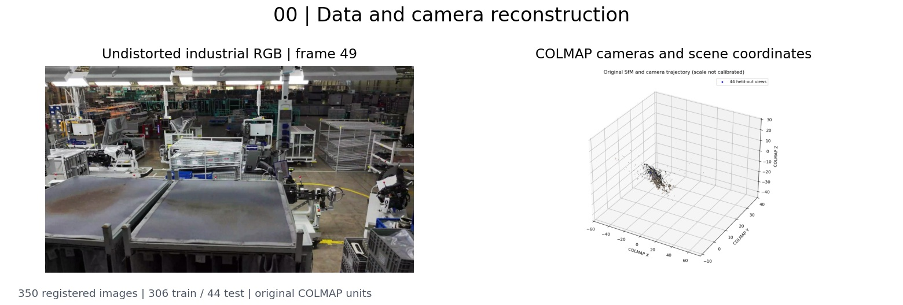

### 01 二维高斯重建

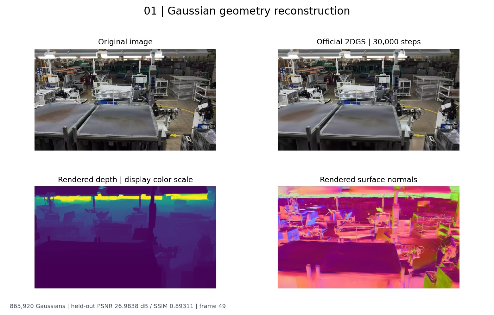

### 02 SAM 分割与语言特征

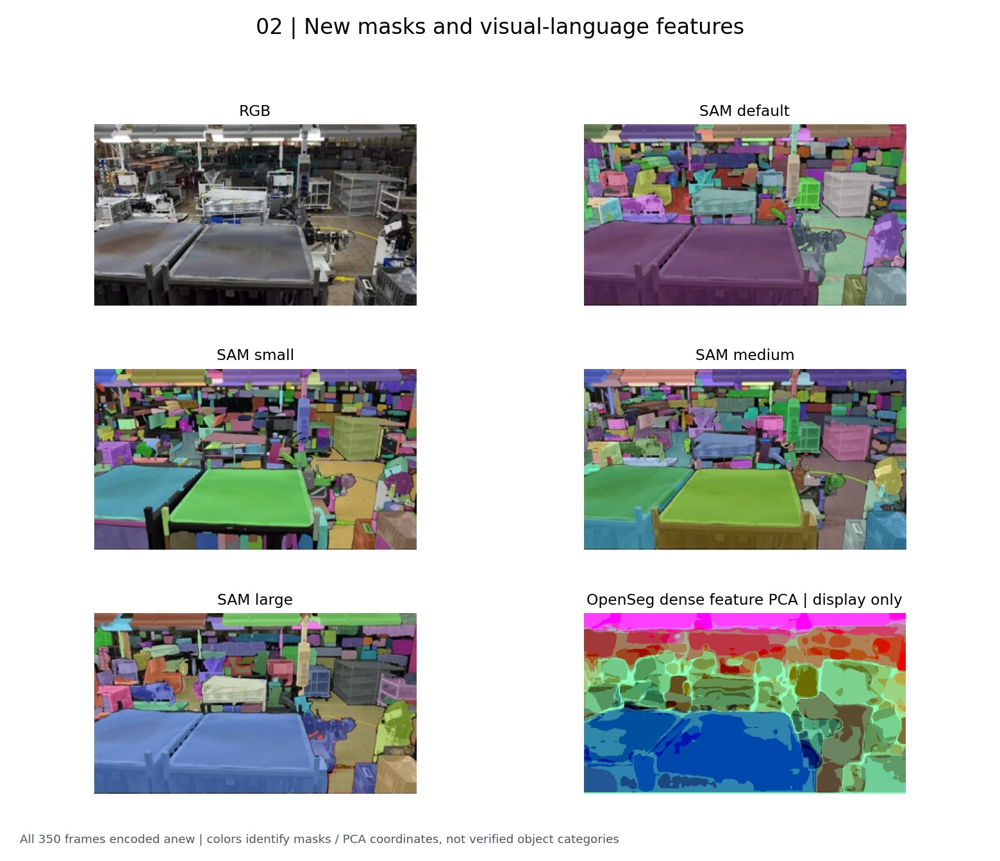

### 03 最大权重高斯裁剪

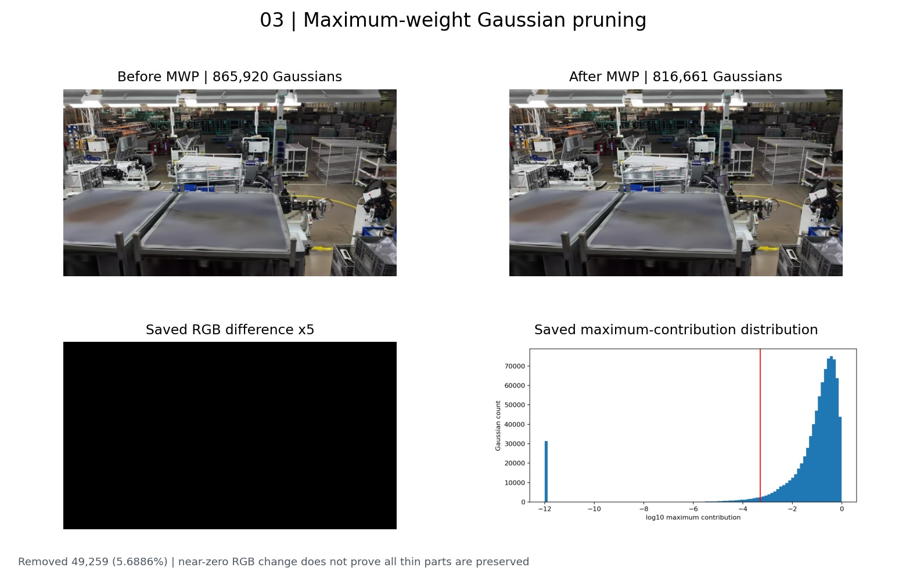

### 04 初始 Superpoint 诊断

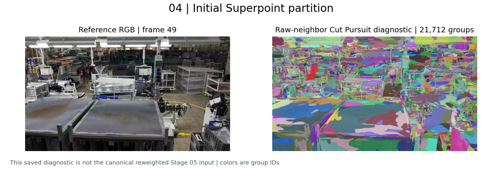

### 05 层次化高斯分组

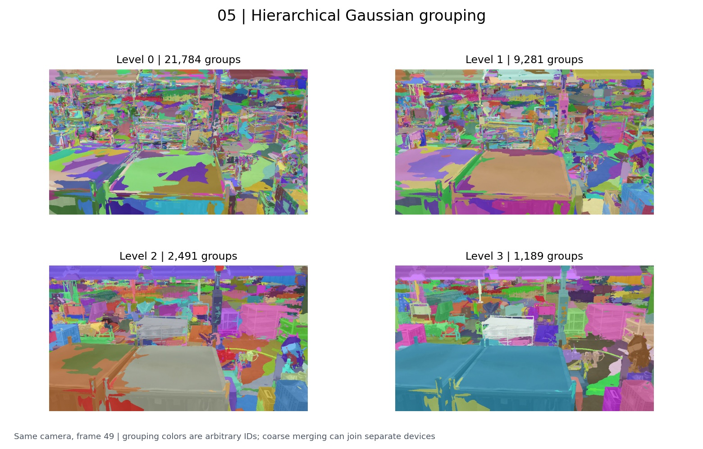

### 06 ROFA 多视角聚合

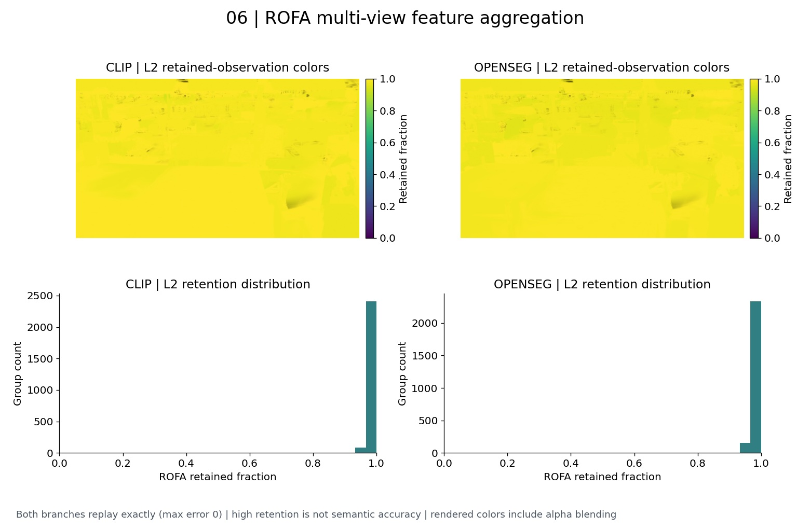

### 07 对象/部件候选层级

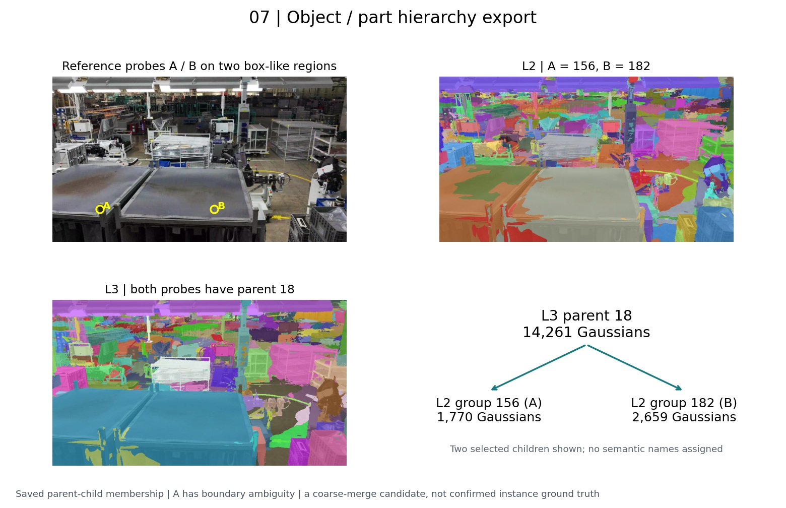

### 08 完整场景图（R1）

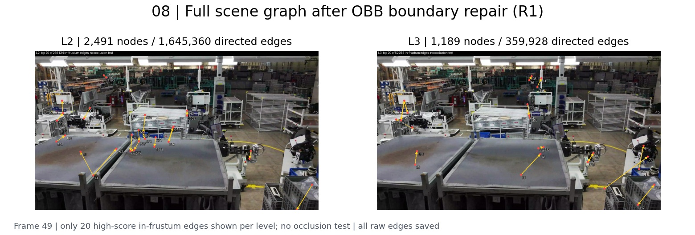

### 09 开放词汇查询

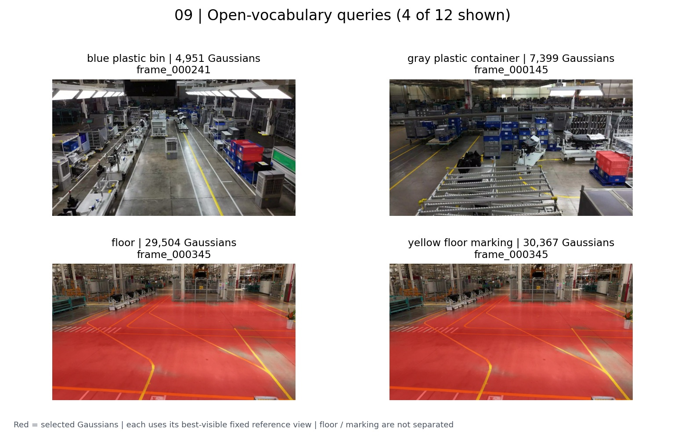

### 09 六项关系查询（R1）

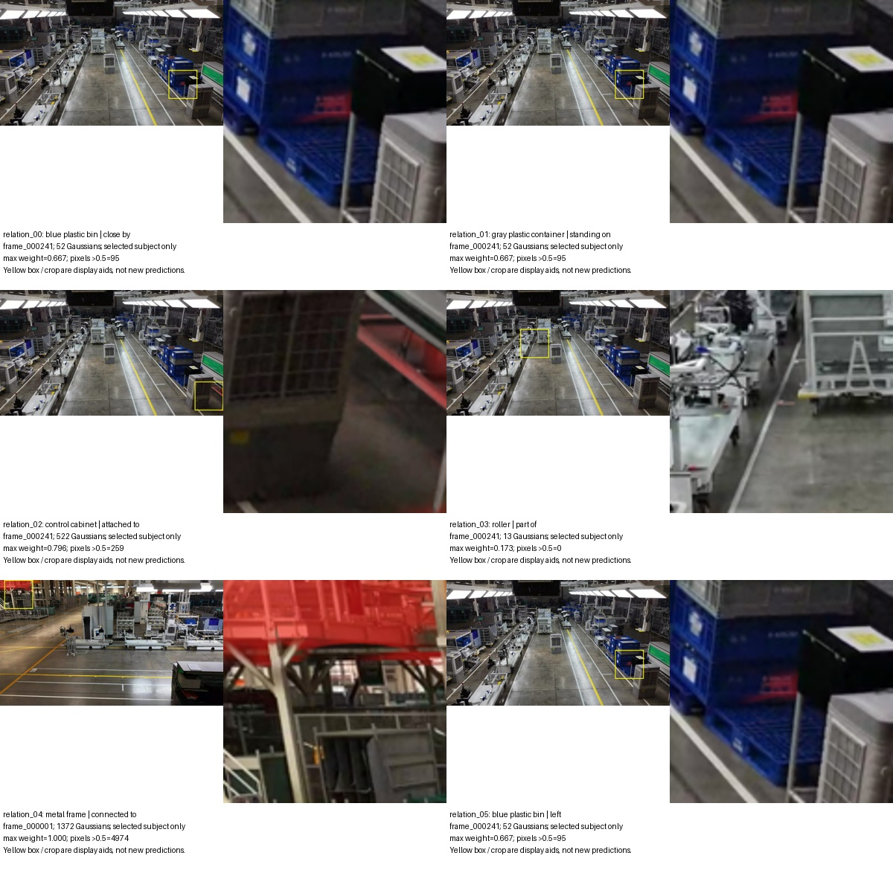

## 来源与许可

上游代码、适配补丁及权重分别遵循其原许可，详见 [THIRD_PARTY.md](THIRD_PARTY.md)。工业结果没有被宣称为人工标注真值。

## M0 v2：三维工业先验工作台

两个工作页：工业场景确定、工业对象确定。自由三维与三个正交视图共用空间框，直接点击设备创建粗略范围，再填写基础双语名称和描述；单张训练 SAM 参考可选。旧七步、区域、多视角掩膜、关系和评价标注不再是保存或导出的要求。

- [启动与操作](m0/README.md) · [真实验收及限制](m0/docs/IMPLEMENTATION_REPORT.md)
- [数据格式](m0/docs/DATA_FORMAT.md) · [M1–M5 接口边界](m0/docs/M1_M5_INTERFACE.md)
- [实际数据状态](m0/docs/DATA_STATUS_AT_DELIVERY.md)：场景、一个实际料架候选和单张参考均为待人工复核的草稿，正式数据未冻结。

M0 不生成最终对象高斯实例、融合语义或场景图。Baseline 0/R1 和原始几何保持原状；V1 代码及数据在服务器完整备份，Git 旧版为 6d50092。原图、模型、标注、备份与工作台截图不进入本次源码提交。
