# 各阶段真实中间结果

主视角为第 49 帧，查询图标出各自视角。颜色为分组 ID/PCA/保留比例，不等同于已确认的设备类别。Stage 08 和关系查询为 R1；原始 Baseline 0 失败记录另存。

## 00 数据与相机

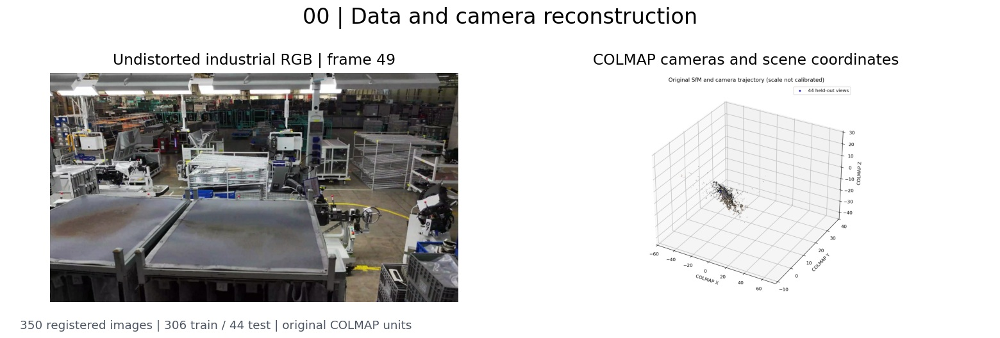

## 01 二维高斯重建

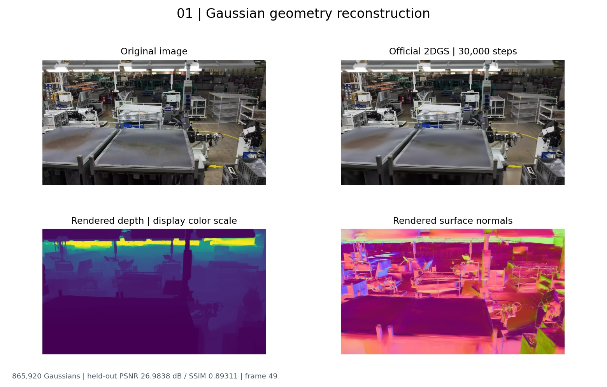

## 02 SAM 分割与语言特征

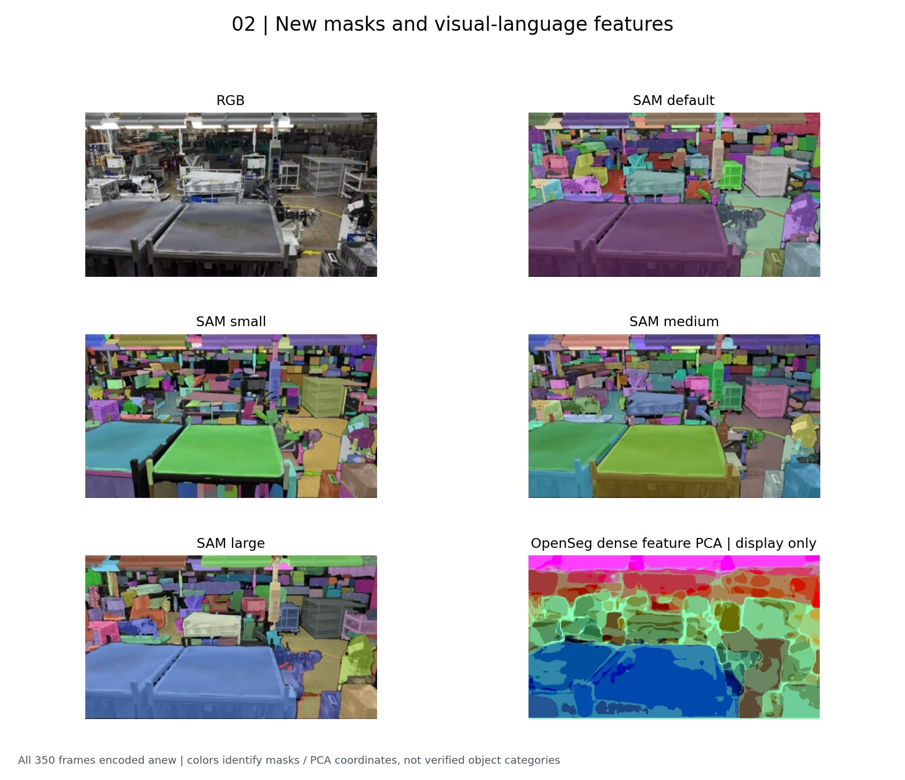

## 03 最大权重高斯裁剪

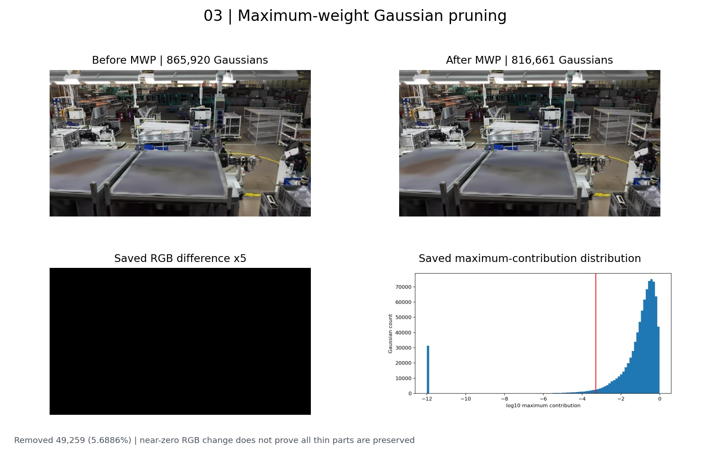

## 04 初始 Superpoint 诊断

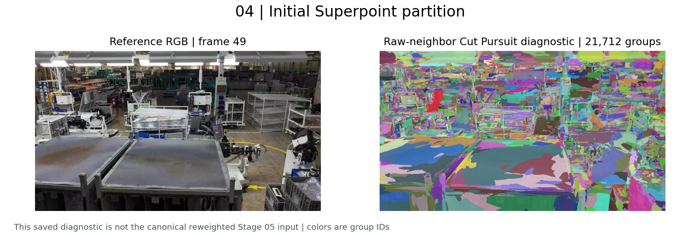

## 05 层次化高斯分组

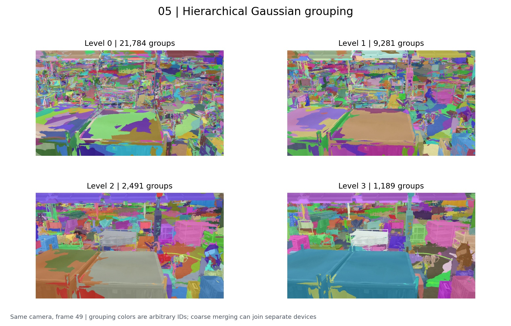

## 06 ROFA 多视角聚合

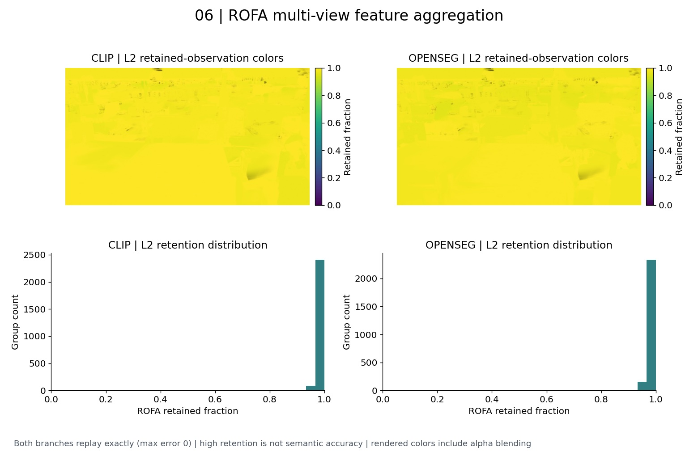

## 07 对象/部件候选层级

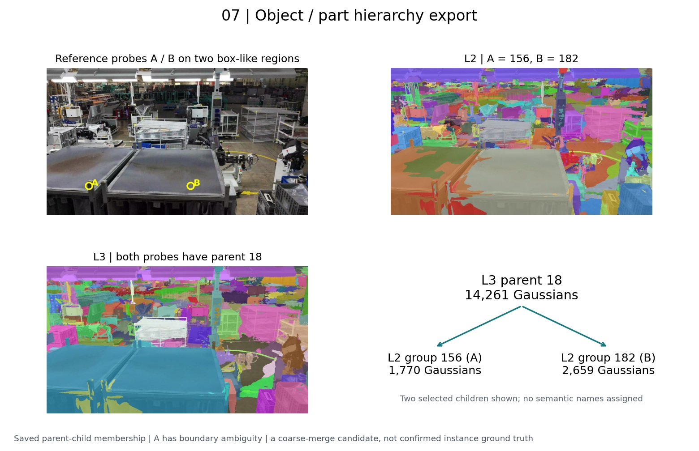

## 08 完整场景图（R1）

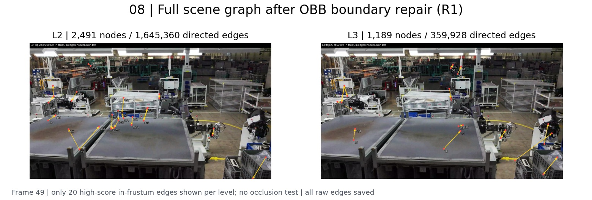

## 09 开放词汇查询

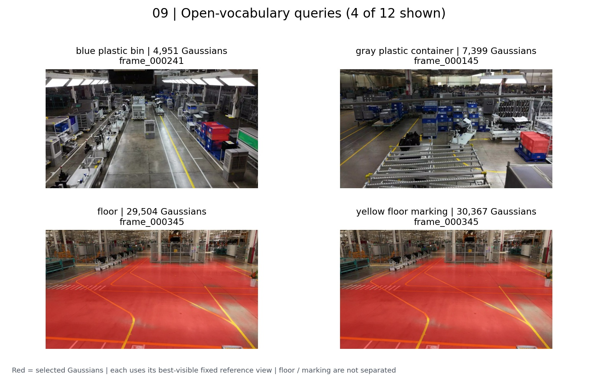

## 09 六项关系查询（R1）

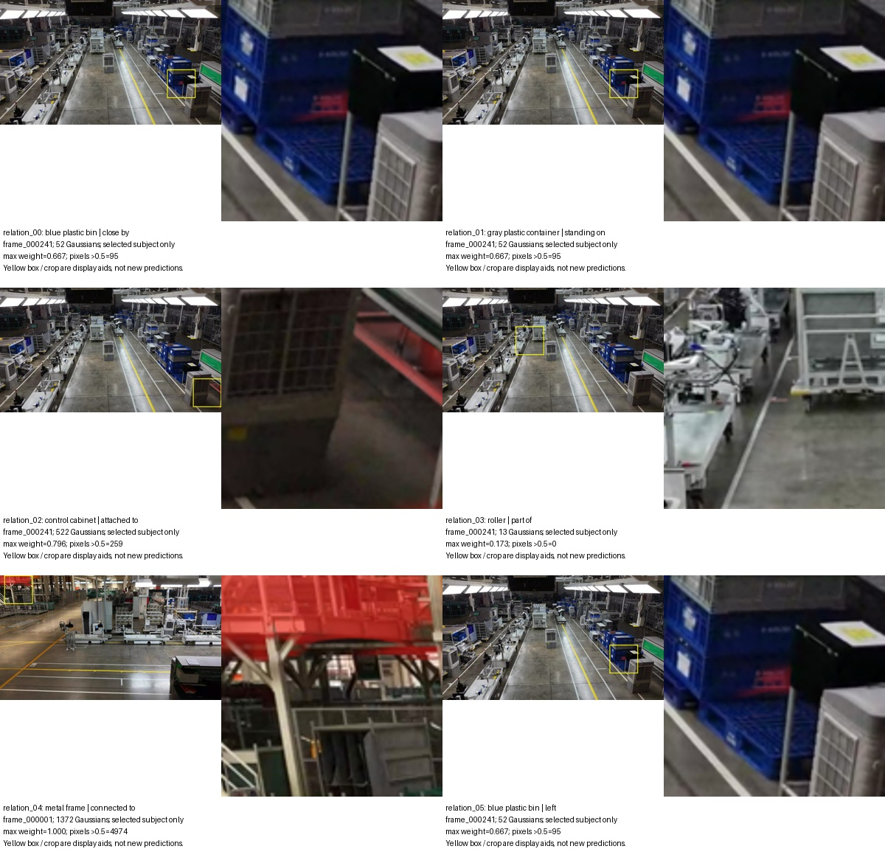

