# 工业世界模型 M1—M5：真实中间结果

实验：`baseline_20261126_r29`，M0 revision 29，原生 3DGS。以下图片均来自已保存的真实运行结果，原样复制，无人工修正掩膜或实例。来源路径及 SHA-256 见 [manifest.json](manifest.json)。

33 个标注对象中，19 个获得有效三维实例，共 185,977 个高斯；14 个对象保留不可用状态。场景图保存 634 条关系。15 项查询产生 5 个空结果、2 个单对象结果和 8 个多对象结果。结果完整可检查，但不代表分割或查询已准确。

前半部分以“装配夹具台 01”为例，串联观察同一对象。

## M1：空间约束与候选高斯

橙色是粗框内的 28,512 个候选高斯，此时仍可能包含地面和邻近结构。

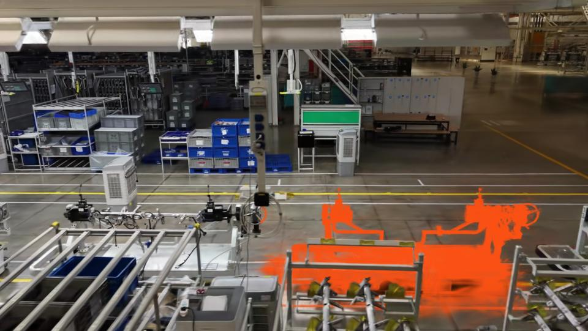

[全部对象候选高亮汇总](figures/candidate_overview.jpg)

## M2.1：有效视角选择

该对象选出 8 个视角；黄色框是三维粗框在原始 RGB 中的投影。全部 33 个对象共选出 91 个对象视角。

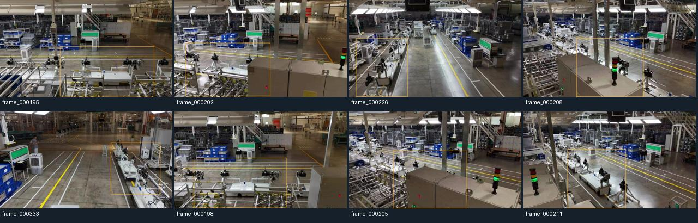

[全部对象的视角选择汇总](figures/selection_overview.jpg)

## M2.2：SAM 分割及异常视角拒绝

绿色表示接受，红色表示拒绝。此对象接受 6 个视角，另外 2 个视角误分到前方柜体，被自动拒绝。全场接受 79 次观测、拒绝 12 次；被接受的掩膜仍可能混入背景或相邻设备。

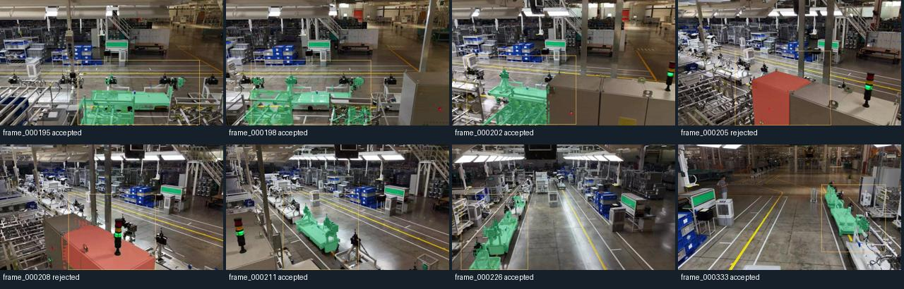

[全场 SAM 汇总，包含拒绝样本](figures/segmentation_overview.jpg)

## M2.3：二维—三维关联得分

绿色为多视角支持较高，红色为支持较低，灰色为未获得有效观测。被遮挡或出视野的高斯不作为负向证据。

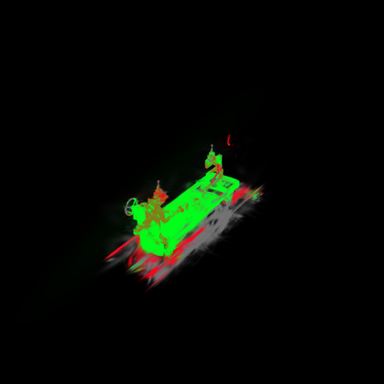

## M2.4：实例提取前后

左列为粗框候选，右列为最终实例；三行依次为斜视、侧视和俯视。此对象最终保留 7,341 个高斯。地面污染减少，但部分立杆、底部支撑和遮挡结构也缺失。

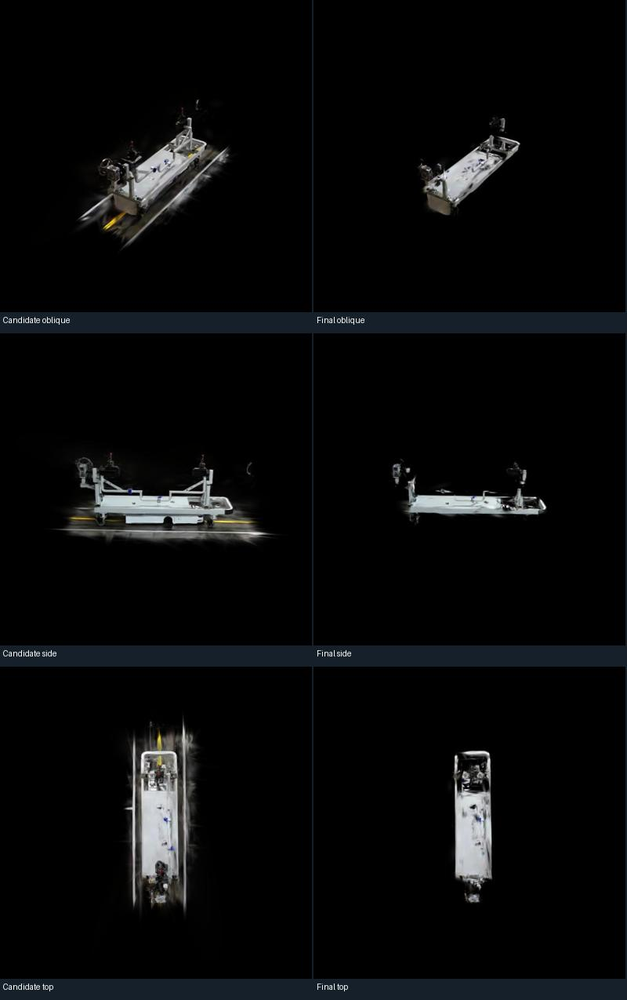

## M2.5：完整场景遮挡下的重投影

从左到右：原始 RGB、输入 SAM 掩膜、最终三维实例投影、差异图。差异图绿色为重合，蓝色为仅 SAM 覆盖，红色为仅三维投影覆盖。

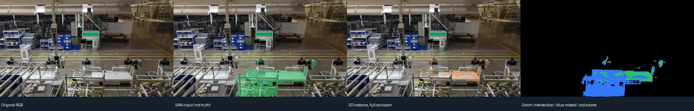

全场内部 IoU 均值为 0.267、SAM 覆盖率均值为 0.271，当前提取偏保守。SAM 是输入，不是独立真值，这些值不能解释为真实分割准确率。

[全部可用对象的重投影汇总](figures/reprojection_overview.jpg)

## M2.6：对象级三维语义地图

不同颜色对应不同实例，背景保留原始外观。仅对成功提取的 19 个对象着色，未用粗框替代不可用对象。

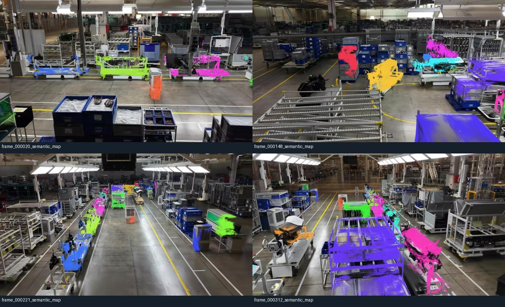

## M3：视觉语言编码与多视角融合

实际送入 CLIP 的多视角裁剪如下，掩膜外区域填充灰色。此对象有 6 个有效视觉观测。

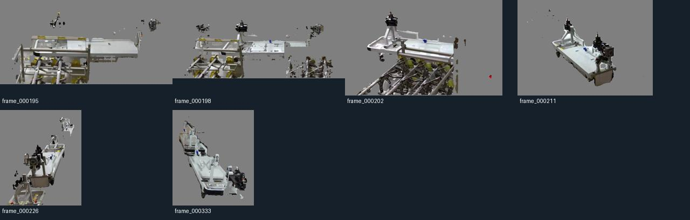

逐视角相似度：

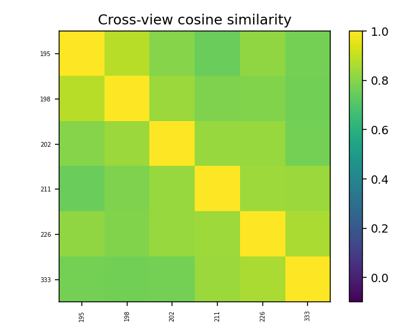

该对象全部 6 个观测参与加权聚合；全场共排除 3 个异常视觉观测。文本分支使用同一 CLIP checkpoint 的兼容编码器；18 个对象缺少英文描述，仅编码已有英文名称，未改写 M0。

以下为对象视觉特征相似度。保留全部 33 个对象的位置；没有视觉特征的行列为零占位，不表示对象之间真的毫不相关。最终只有同时具有有效三维实例和视觉证据的 19 个对象进入可用查询集合。

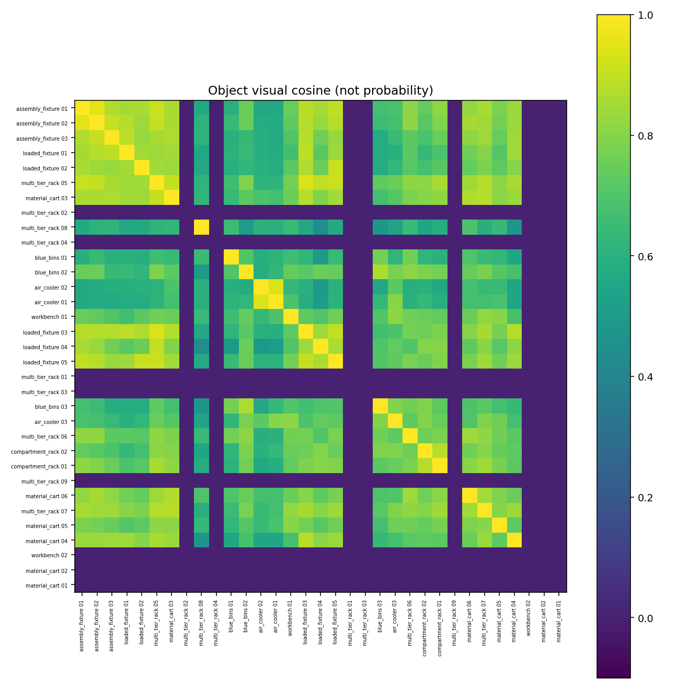

同类别平均视觉余弦为 0.849，不同类别为 0.741，区分间隔仍较小。余弦相似度不是概率。

## M4：工业三维场景图

点为最终实例中心，连线仅展示 `near` 邻近关系；完整 JSON 保存 634 条关系。坐标固定为 +X 向右、+Y 向前、+Z 向上，单位为 SfM 相对单位。

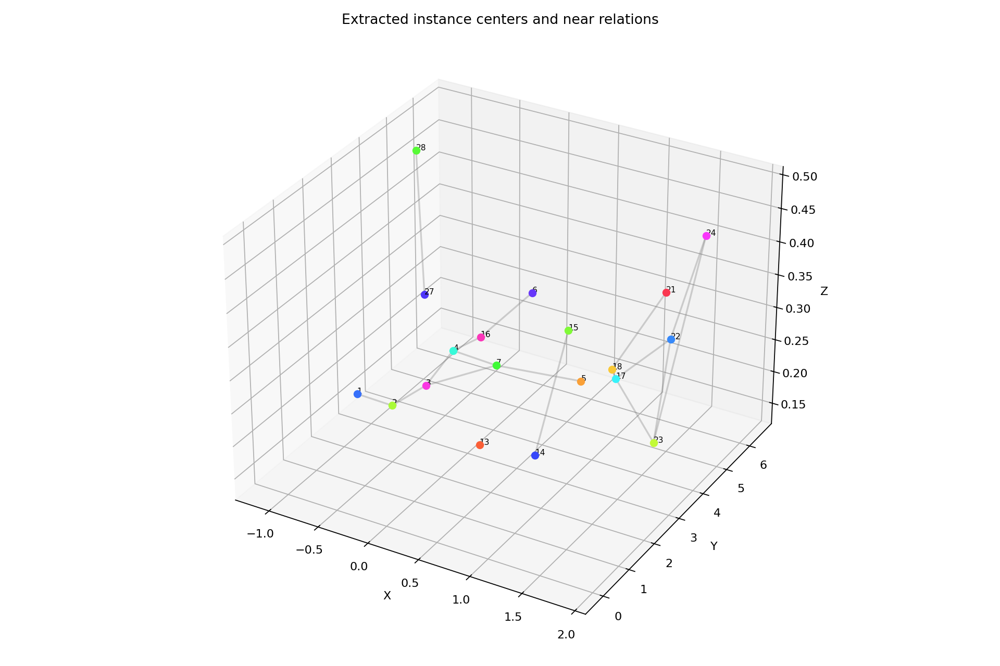

[带对象名称的平面邻近关系图](figures/scene_graph_near.png)

## M5：关系查询与三维定位

查询：“找到料架左侧的物料车”。返回物料车 03 和 06。“左侧”由工业坐标判定，不随当前相机改变。下面为一个参考视角下的高亮结果，另一返回对象在该视角不可完整看到。

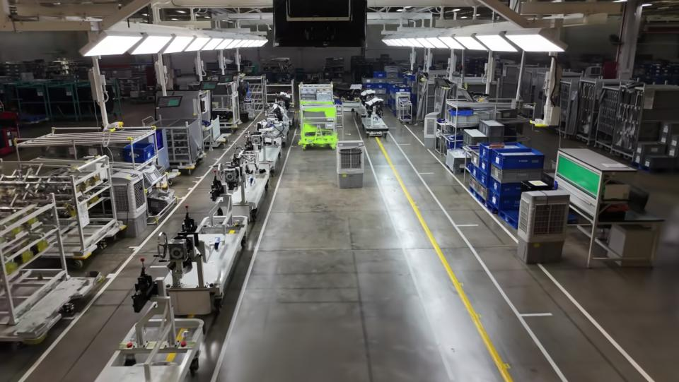

两个返回对象的独立渲染仍可见残缺：

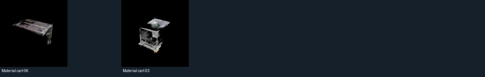

外观查询“蓝色物料箱转运车”出现宽泛匹配，关系查询也可能继承锚点歧义。本次保留实际结果，没有调低阈值补结果，也没有人工筛掉错误匹配。

## 独立世界模型读取验证

把原工程和 M0 数据库路径设置为无效后，模型仍能使用包内代码和权重在 CPU 上查询“装配夹具台 01”，并以包内原生 3DGS 生成下图。查询不导入 SAM，不重新进行三维提取。

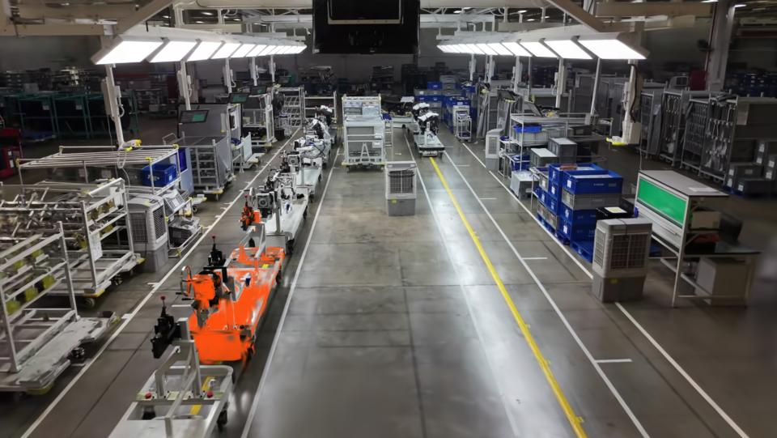

[完整运行方式、独立阶段入口及读取接口](../../industrial_world_model/README.md)
