# All 25 queries and both fixed views

SAM-assisted reference; excluded samples retained and labelled N/A.

## Q001: upright portable air cooler to the left of the workbench

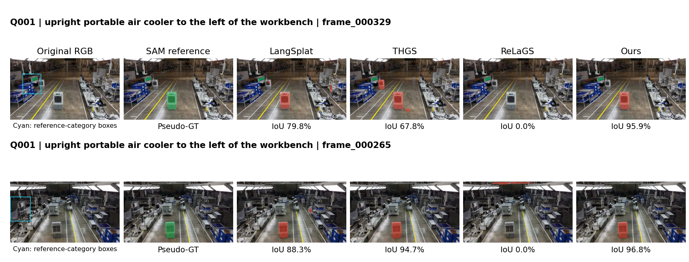

## Q002: group of blue storage bins to the left of the compartmented material rack

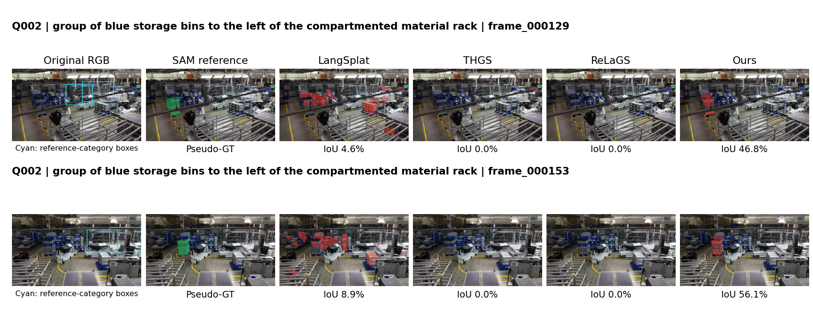

## Q003: fixture table carrying a black workpiece to the left of the material cart

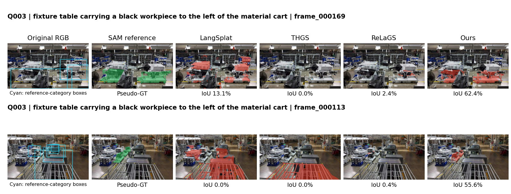

## Q004: workbench to the left of the upright portable air cooler

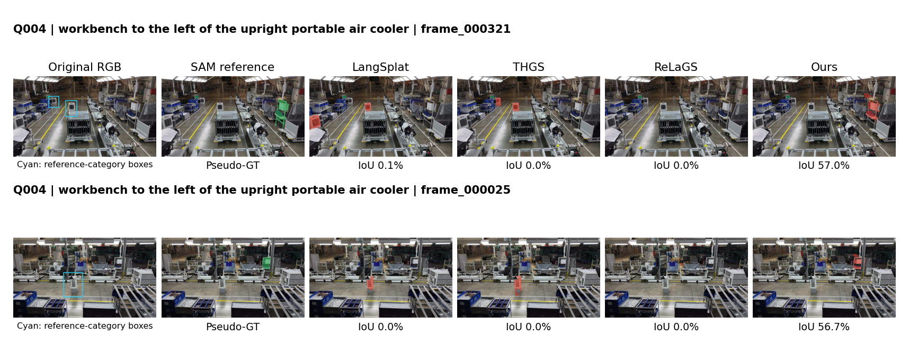

## Q005: multi-tier material rack to the left of the assembly fixture table

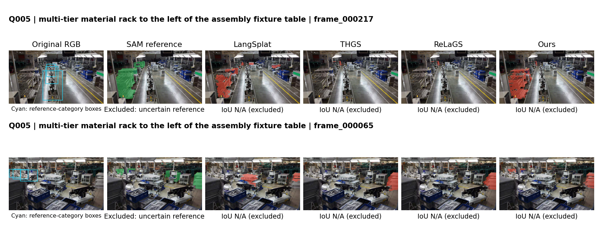

## Q006: material cart to the right of the multi-tier material rack

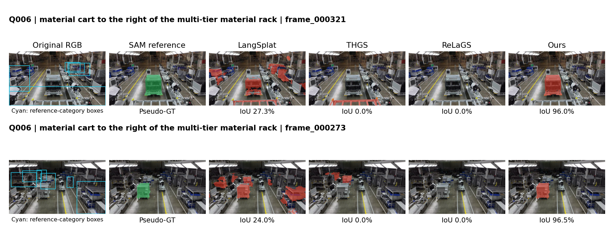

## Q007: multi-tier material rack to the right of the group of blue storage bins

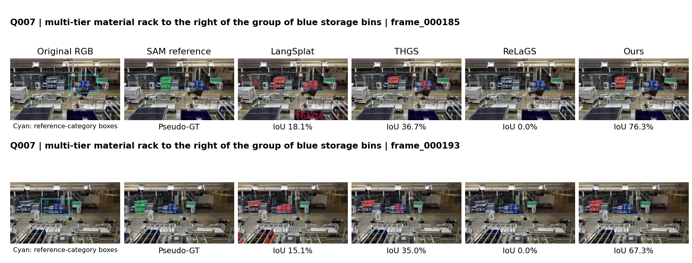

## Q008: workbench to the right of the fixture table carrying a black workpiece

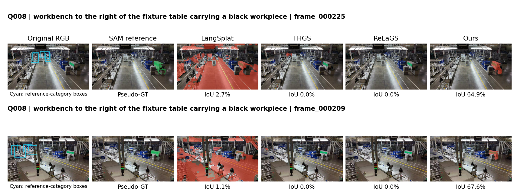

## Q009: fixture table carrying a black workpiece to the right of the assembly fixture table

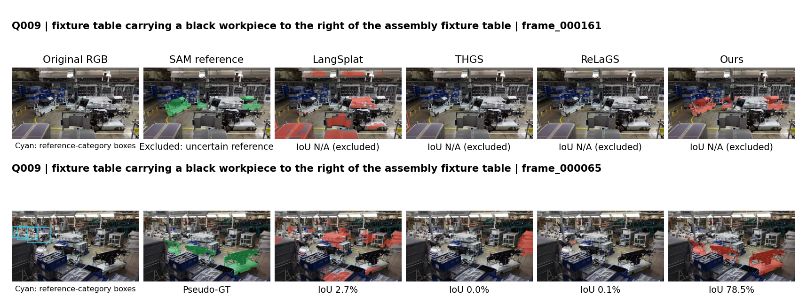

## Q010: group of blue storage bins to the right of the upright portable air cooler

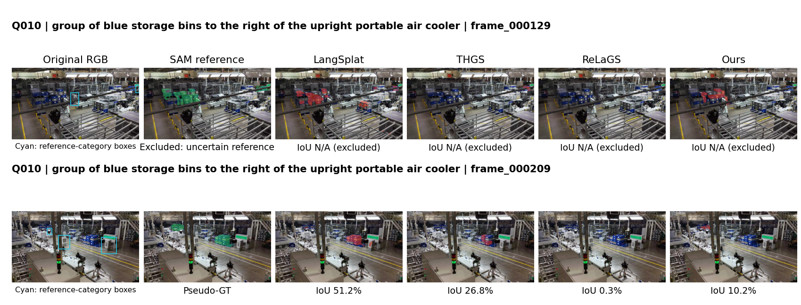

## Q011: assembly fixture table in front of the group of blue storage bins

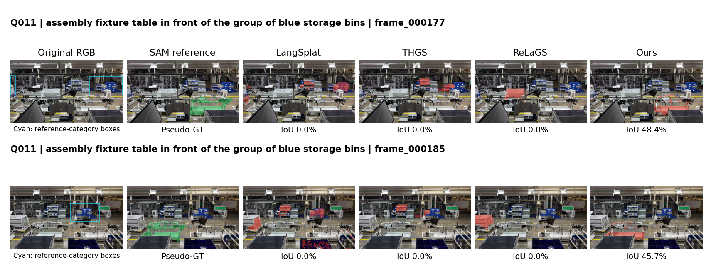

## Q012: compartmented material rack in front of the fixture table carrying a black workpiece

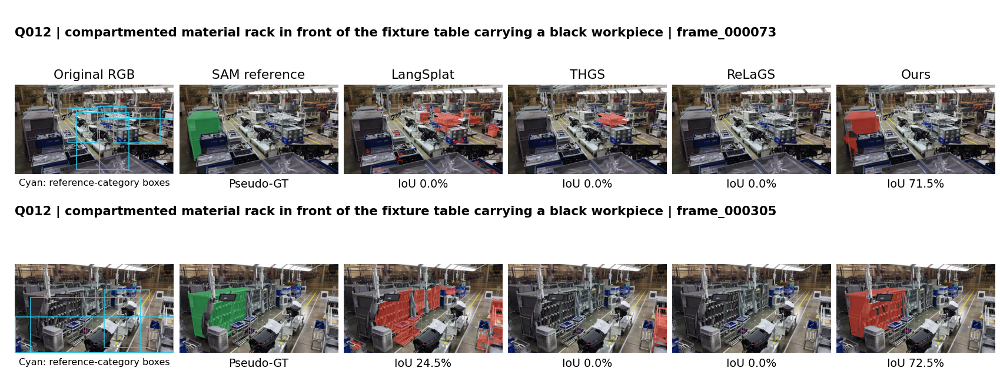

## Q013: material cart in front of the compartmented material rack

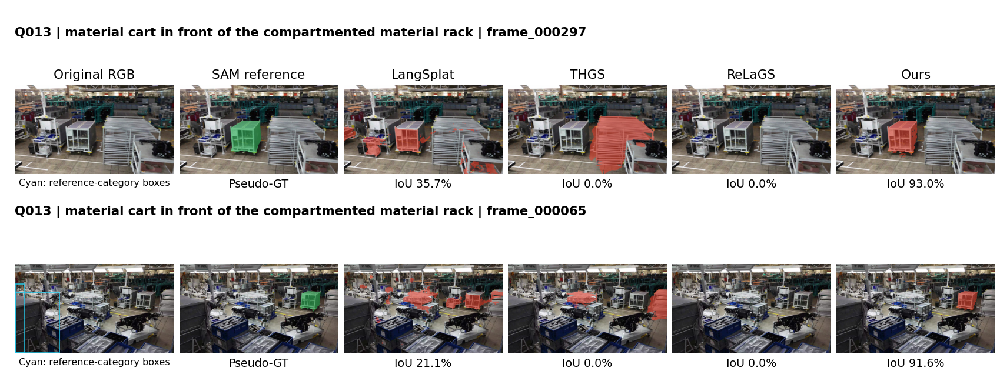

## Q014: upright portable air cooler in front of the material cart

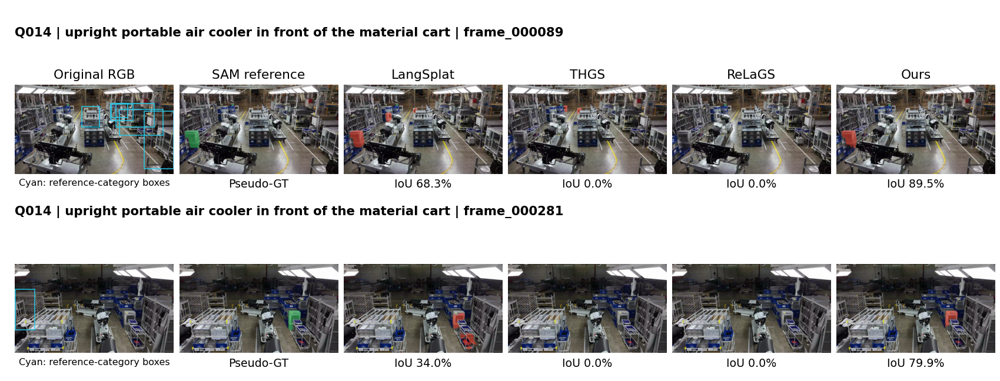

## Q015: workbench in front of the multi-tier material rack

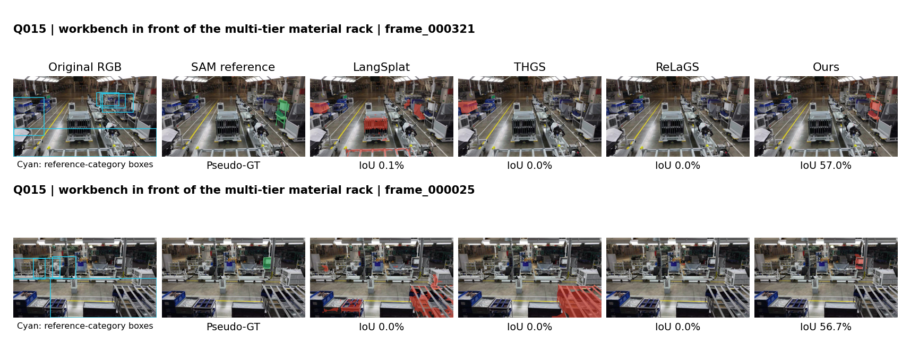

## Q016: assembly fixture table behind the workbench

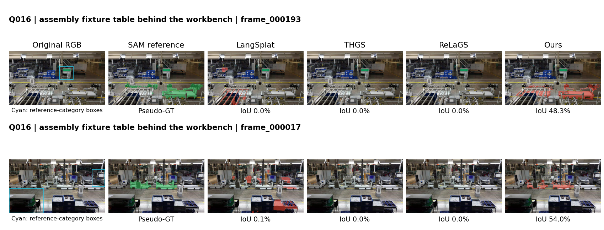

## Q017: compartmented material rack behind the upright portable air cooler

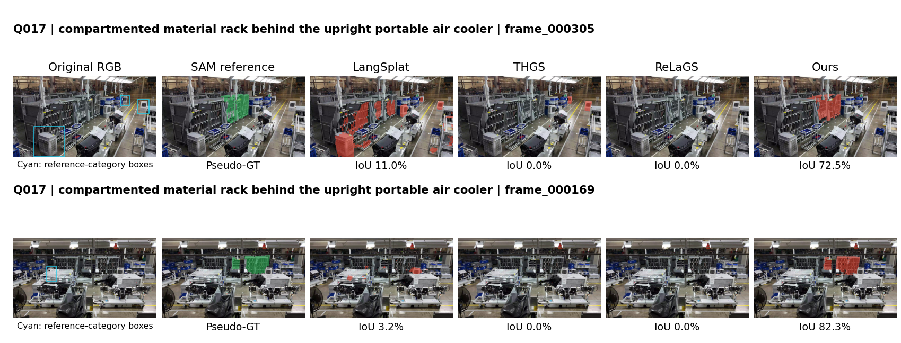

## Q018: fixture table carrying a black workpiece behind the compartmented material rack

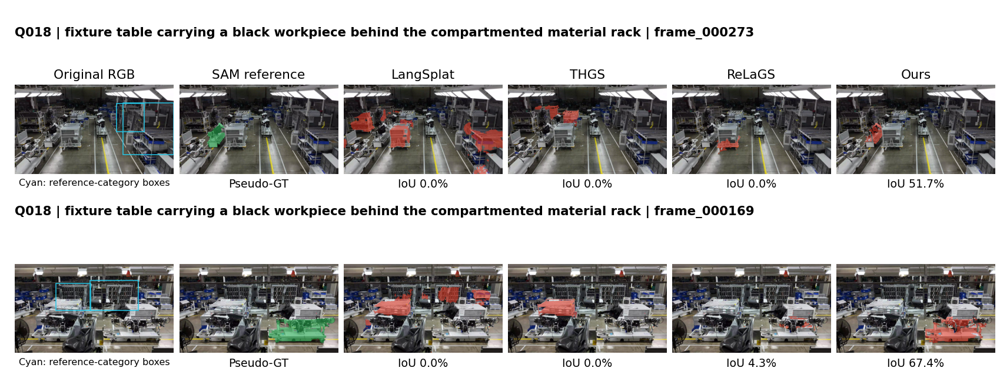

## Q019: group of blue storage bins behind the workbench

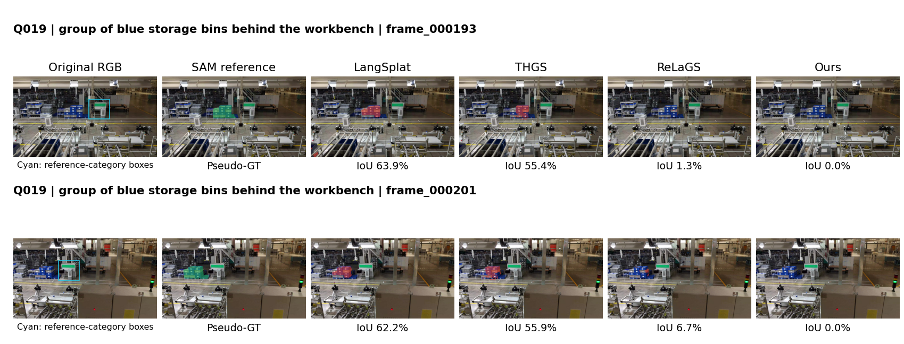

## Q020: multi-tier material rack behind the assembly fixture table

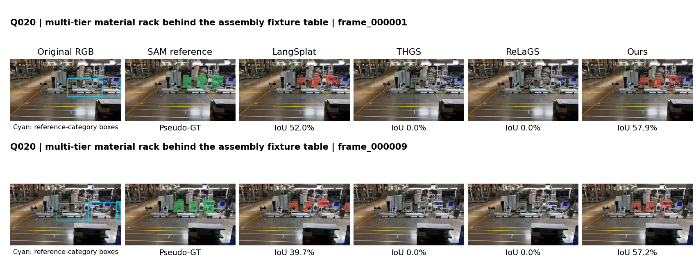

## Q021: upright portable air cooler near the multi-tier material rack

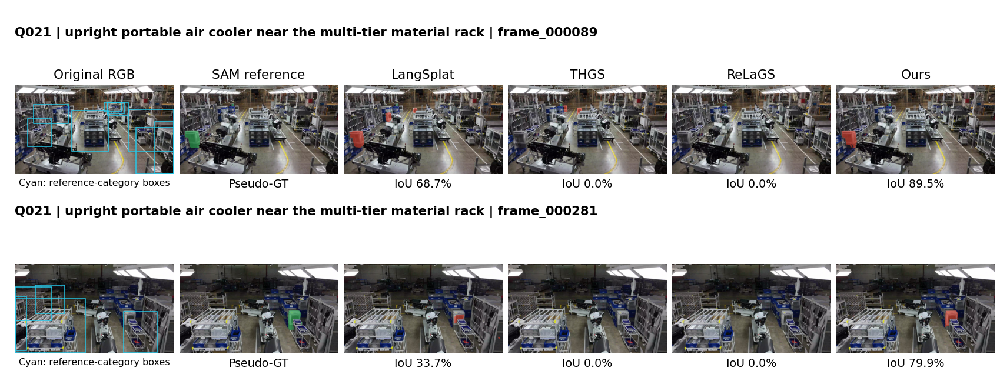

## Q022: assembly fixture table near the fixture table carrying a black workpiece

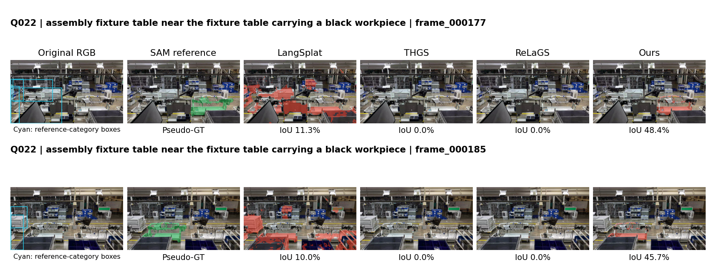

## Q023: compartmented material rack near the group of blue storage bins

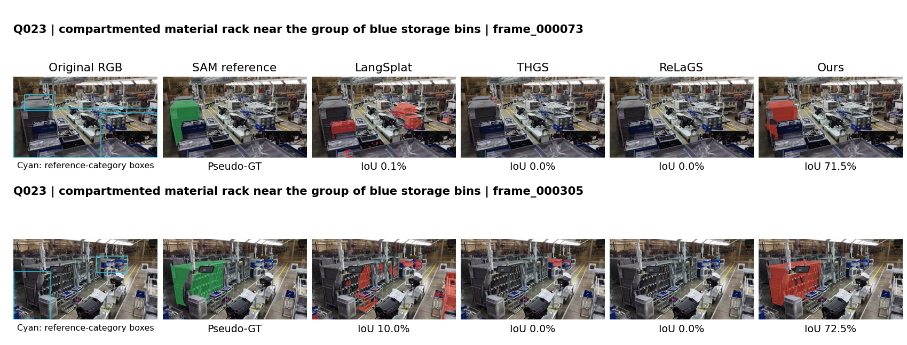

## Q024: material cart near the workbench

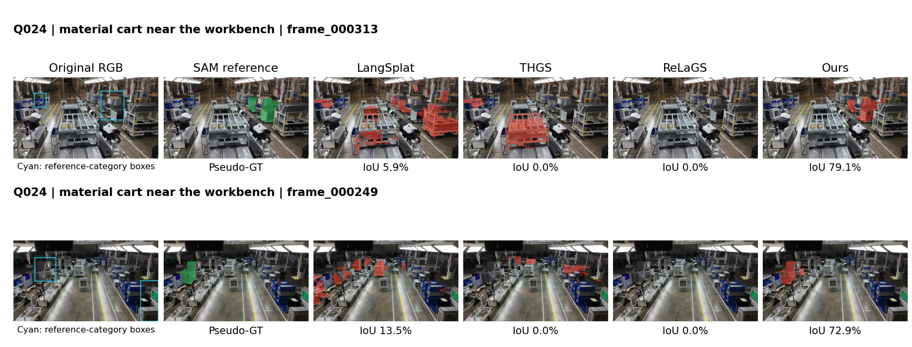

## Q025: multi-tier material rack near the material cart

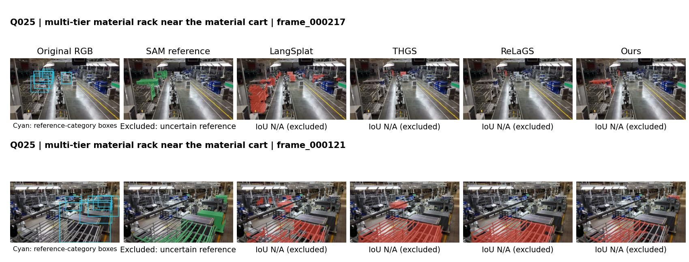
