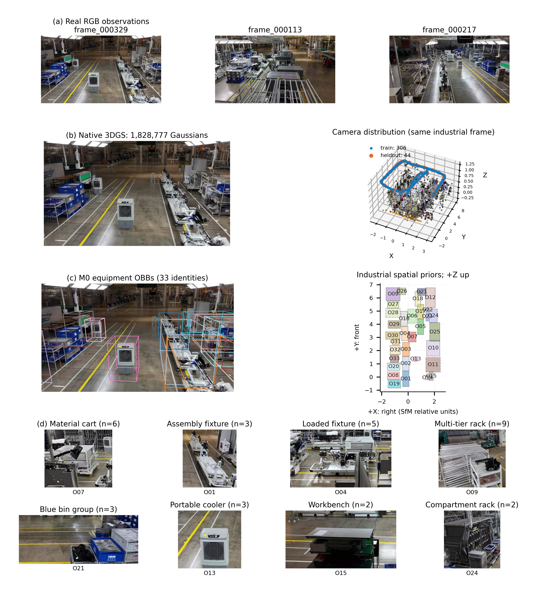
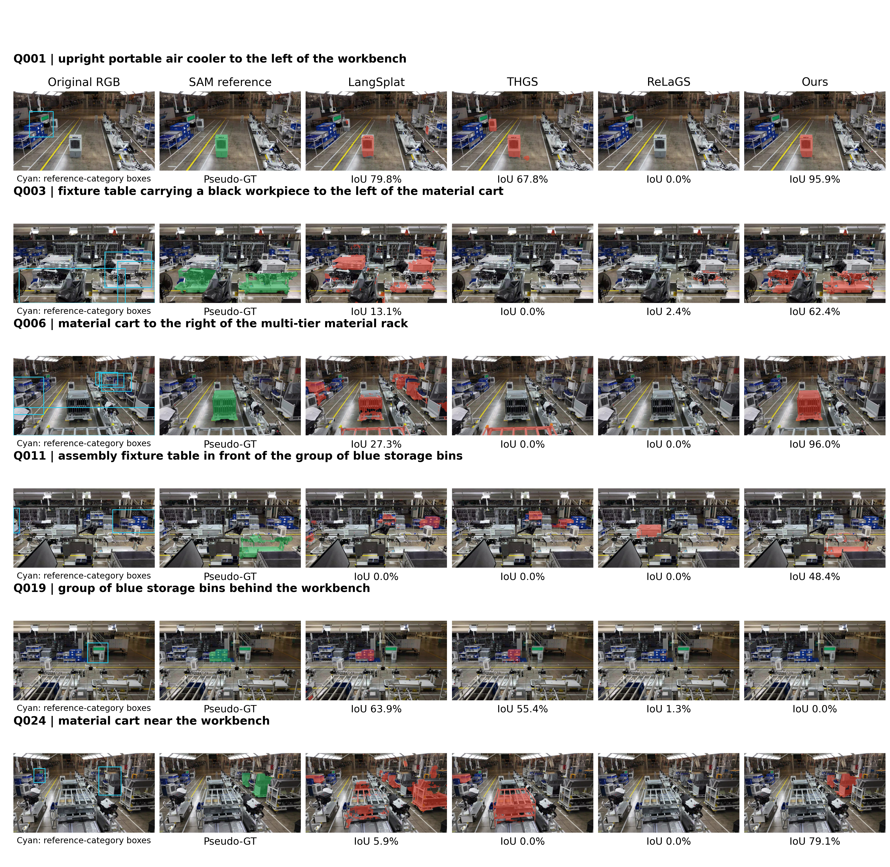
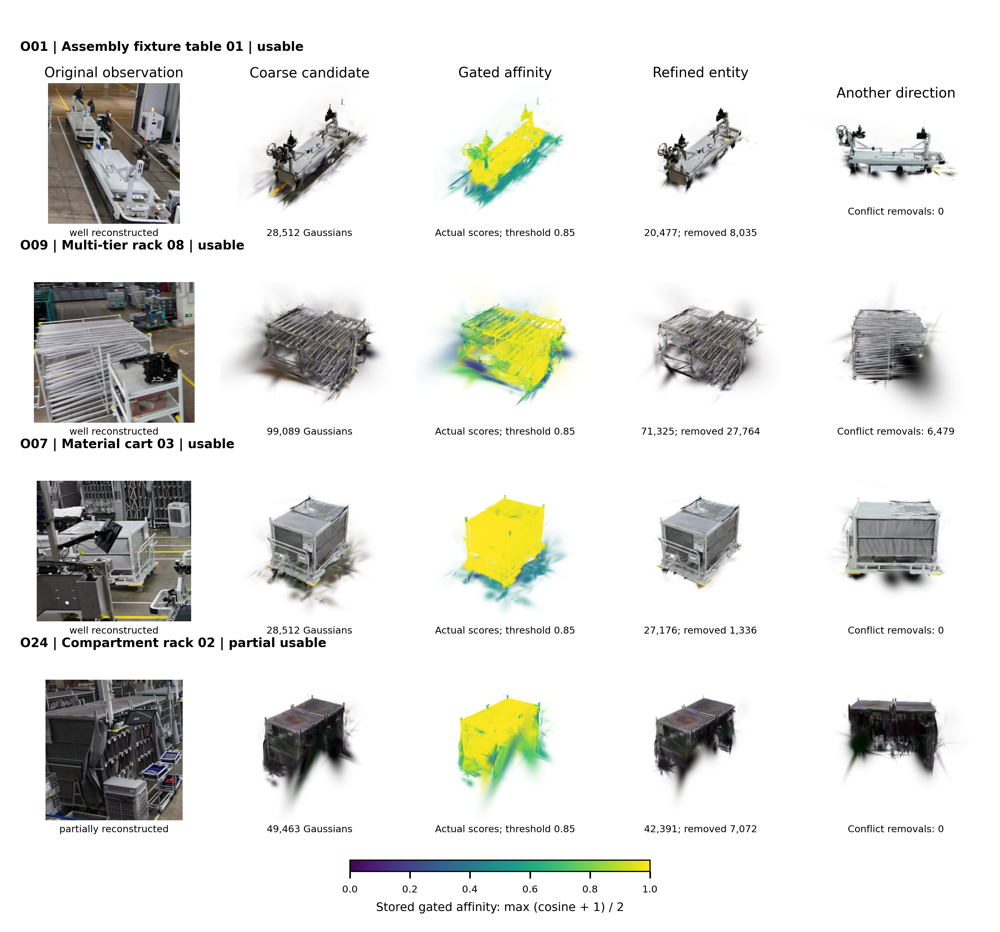
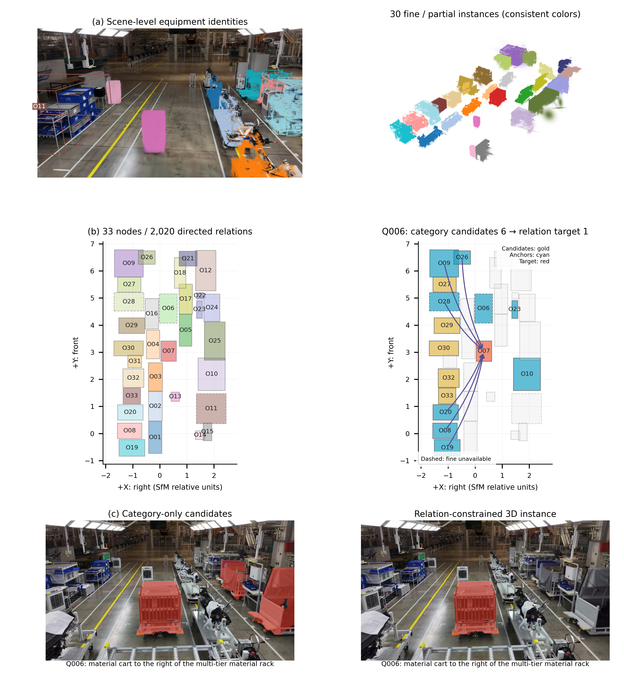
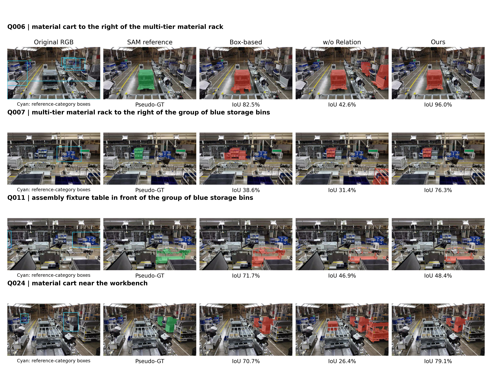
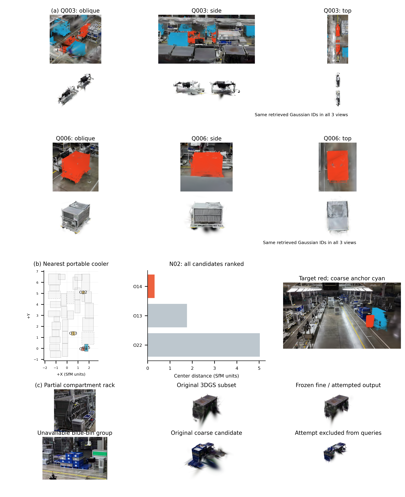
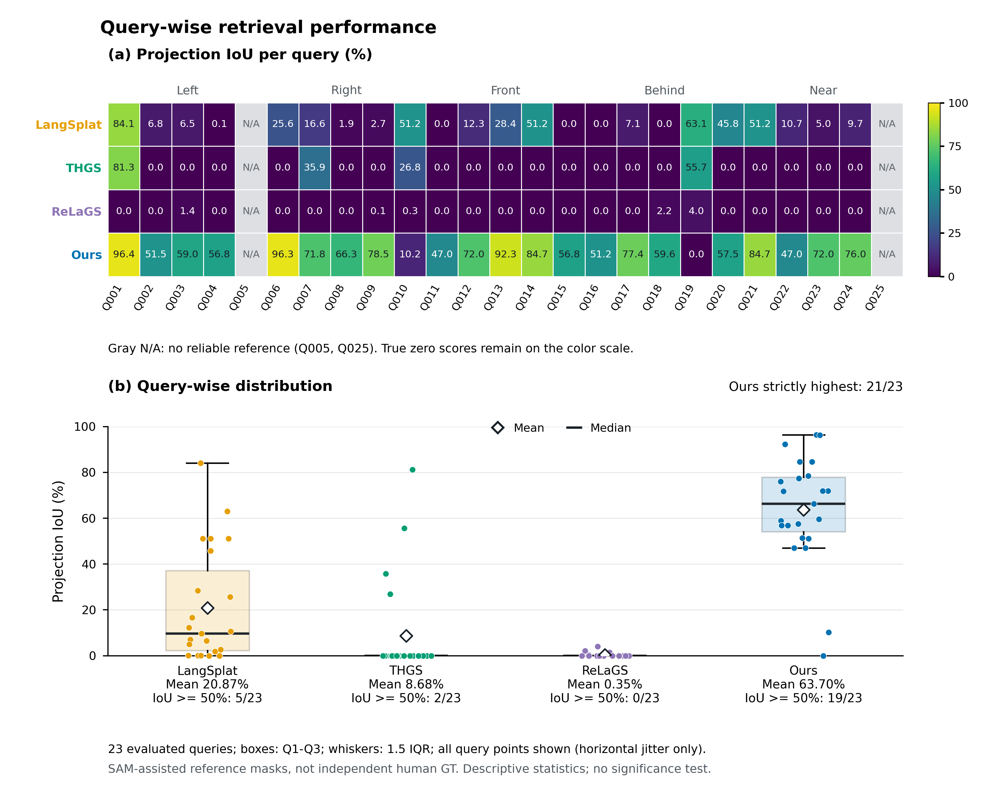
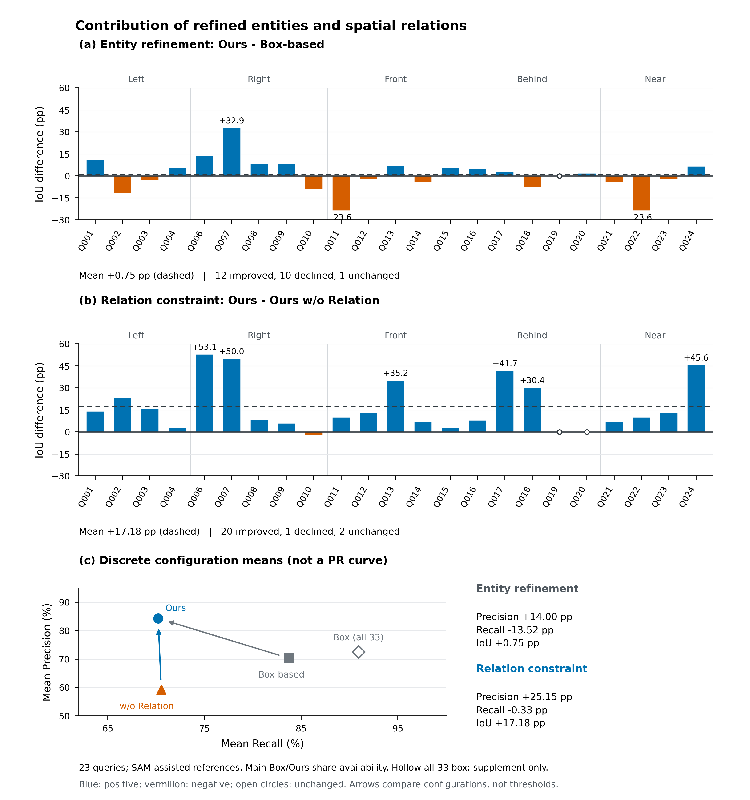
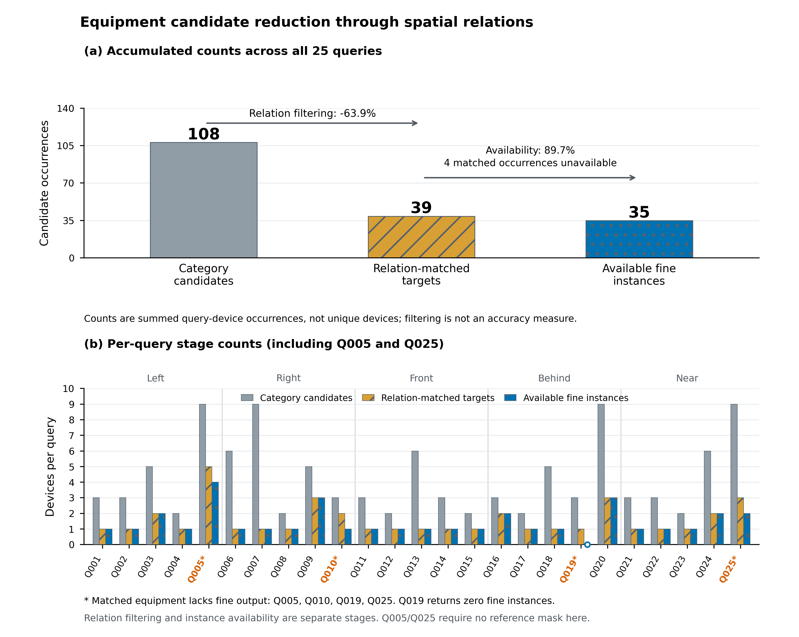

# 论文实验图集

所有图片来自实际RGB、冻结预测或原生3DGS渲染。参考为SAM-assisted Pseudo-GT，未经独立人工真值认证。

[完整外部25查询](../E01_external_comparison/GALLERY.md) · [完整消融25查询](../E02_ablation/GALLERY.md) · [实验报告](../EXPERIMENT_REPORT.md)

## F04_dataset: 工业场景数据及设备空间先验

Industrial scene dataset and equipment spatial priors.

真实RGB、原生3DGS、306训练/44留出相机及33设备的粗框和八类分布。M0仍为历史draft状态；坐标使用SfM相对单位。

Real RGB observations, the native Gaussian scene, 306 training and 44 held-out cameras, and 33 coarse equipment priors in eight categories. Camera points use the industrial frame; sparse Gaussian centers in the camera plot are for visualization. M0 remains historically marked draft.

实验：Dataset。实际案例与文件哈希见[来源](../figures/F04_dataset/sources.json)及[布局](../figures/F04_dataset/layout.json)。[可编辑SVG](../figures/F04_dataset/F04_dataset.svg) · [独立子图](../figures/F04_dataset/subplots/)

## F05_external_comparison: 空间关系引导工业实例检索的外部对比

Qualitative comparison of spatial relation-guided industrial instance retrieval.

六个真实案例覆盖五种关系，包含外部方法有效的Q001、复杂夹具Q003及本文精细实例不可用的Q019。绿为SAM辅助参考，红为各方法预测，青框为参照类别M0位置，仅用于阅读。

Six cases cover five relations, including strong external performance (Q001), complex fixtures (Q003), and unavailable fine output (Q019). Green denotes SAM-assisted reference masks, red frozen predictions, and cyan coarse reference-category boxes for explanation only. Each row uses identical camera and image extent.

实验：E01_external_comparison。实际案例与文件哈希见[来源](../figures/F05_external_comparison/sources.json)及[布局](../figures/F05_external_comparison/layout.json)。[可编辑SVG](../figures/F05_external_comparison/F05_external_comparison.svg) · [独立子图](../figures/F05_external_comparison/subplots/)

## F06_entity_construction: 工业先验引导的三维关系实体构建

Industrial prior-guided construction of 3D relation entities.

四台设备的粗候选、真实尺度门控亲和度与精细实例采用相同相机和裁剪。亲和度来自冻结float16数据，正式筛选使用已保存索引；O09另有6479个冲突高斯重新分配。数量减少不代表分割精度。

Coarse candidates, actual gated affinities and refined entities share camera and crop per equipment item. Affinity colors use frozen float16 values; exact stored selection indices define threshold membership. O09 loses 6,479 Gaussians during inter-instance conflict assignment. Count reduction is not an accuracy measure.

实验：E03。实际案例与文件哈希见[来源](../figures/F06_entity_construction/sources.json)及[布局](../figures/F06_entity_construction/layout.json)。[可编辑SVG](../figures/F06_entity_construction/F06_entity_construction.svg) · [独立子图](../figures/F06_entity_construction/subplots/)

## F07_relation_retrieval: 工业空间关系表达与关系约束检索

Industrial spatial relation representation and relation-constrained retrieval.

完整身份表达和工业俯视布局对应33节点、2020边；30个可用精细/局部实例，3个位置节点保留。Q006先匹配6个物料车，再以全部料架参照集合筛出1个目标；图中只绘制该查询的实际关系。

The scene representation contains 33 identity nodes and 2,020 directed relations, with 30 fine/partial instances and three location-only nodes. Q006 reduces six material-cart candidates to one by union-over-anchors relation filtering. Only actual representative query edges are drawn; object colors/IDs remain consistent.

实验：E04。实际案例与文件哈希见[来源](../figures/F07_relation_retrieval/sources.json)及[布局](../figures/F07_relation_retrieval/layout.json)。[可编辑SVG](../figures/F07_relation_retrieval/F07_relation_retrieval.svg) · [独立子图](../figures/F07_relation_retrieval/subplots/)

## F08_ablation: 精细实体和空间关系约束的消融结果

Qualitative ablation of refined entities and spatial relation constraints.

相同可用性门控下比较粗框、无关系和完整方法。Q006/Q007体现剔除背景收益；Q011保留精细提取造成召回下降的反例；Q024说明同类设备筛选。

Box-based and full Ours share equipment availability. Q006/Q007 show gains from removing contamination, Q011 retains a counterexample with lost structure, and Q024 illustrates same-category disambiguation. All masks use identical fixed cameras and the same contribution threshold.

实验：E02_ablation。实际案例与文件哈希见[来源](../figures/F08_ablation/sources.json)及[布局](../figures/F08_ablation/layout.json)。[可编辑SVG](../figures/F08_ablation/F08_ablation.svg) · [独立子图](../figures/F08_ablation/subplots/)

## F09_multiview_application: 多视角关系检索及工业应用展示

Multi-view relational retrieval and industrial application examples.

Q003和Q006各只执行一次三维检索，再从三方向渲染相同高斯集合。最近查询N02使用M0中心距离；困难案例区分局部重建与不可用精细输出。不可用蓝箱的尝试结果仅作诊断，不参与正式查询。

Each of Q003 and Q006 is retrieved once and its unchanged Gaussian set rendered from three directions. N02 ranks cooler candidates by M0 center distance in SfM units. Difficult cases distinguish partial reconstruction from unavailable fine output. The blue-bin extraction attempt is diagnostic and is excluded from normal query output.

实验：E05。实际案例与文件哈希见[来源](../figures/F09_multiview_application/sources.json)及[布局](../figures/F09_multiview_application/layout.json)。[可编辑SVG](../figures/F09_multiview_application/F09_multiview_application.svg) · [独立子图](../figures/F09_multiview_application/subplots/)

<!-- DATA_ANALYSIS_F10_F12_START -->
## F10—F12：冻结实验数据分析

只重读原有CSV/JSON并绘图，未运行新实验。图中文字与标记为可编辑矢量；PNG为450 dpi。

### F10_query_performance: 不同方法的空间关系引导实例检索性能分布

Query-wise performance distribution of spatial relation-guided instance retrieval.

(a) 25条查询按原顺序展示，Q005/Q025缺少可靠参考，标灰N/A；真实零值保留在色标中。(b) 23条有效查询逐查询IoU分布，均值为LangSplat 20.87%, THGS 8.68%, ReLaGS 0.35%, Ours 63.70%；Ours在21/23条中严格最高。箱体为Q1—Q3、中线为中位数、菱形为均值，须端为1.5 IQR范围内的实际极值；展示全部查询点，仅进行固定种子水平抖动。两阶段平均：先有效视角、后等权查询。参考为SAM辅助伪真值，非独立人工真值；查询可能共享设备或视角，不进行显著性检验。

(a) All 25 queries retain their original order. Q005/Q025 lack reliable references and are gray N/A; genuine zeros remain on the color scale. (b) All 23 evaluated query IoUs are shown. Means: LangSplat 20.87%, THGS 8.68%, ReLaGS 0.35%, Ours 63.70%. Ours is strictly highest on 21/23 queries. Boxes span Q1-Q3, center lines are medians, diamonds are means, and whiskers end at observations within 1.5 IQR. Jitter is horizontal only with a fixed seed. Metrics average eligible views first, then queries equally. References are SAM-assisted Pseudo-GT, not independent human GT. Queries can share devices/views; no significance test is performed.

[SVG](../figures/F10_query_performance/F10_query_performance.svg) · [PDF](../figures/F10_query_performance/F10_query_performance.pdf) · [独立子图](../figures/F10_query_performance/subplots/) · [数据/来源](../figures/F10_query_performance/sources.json)

### F11_mechanism_contribution: 精细三维实体表达与空间关系约束的贡献分析

Contribution analysis of refined entity representation and spatial relation constraints.

(a,b) 同23条查询、同纵轴范围的有符号IoU差值。精细实体相对同可用性粗框平均+0.75 pp，12升/10降/1不变；关系约束平均+17.18 pp，20升/1降/2不变，保留所有负值和零值。(c) 四种配置的离散Precision/Recall均值，非PR曲线；箭头仅表示两个主要机制配置差异。精细实体Precision +14.00 pp、Recall -13.52 pp；关系约束Precision +25.15 pp、Recall -0.33 pp。空心all-33粗框使用不同可用性，仅作补充，不能当作单一机制对照。SAM辅助伪真值。

(a,b) Signed IoU differences use the same 23-query order and axis range. Entity refinement versus availability-matched boxes averages +0.75 pp (12 improved/10 declined/1 unchanged); relation constraints average +17.18 pp (20/1/2). All negatives and zeros remain. (c) Discrete configuration means, not a precision-recall curve. Arrows show only the two main configuration contrasts. Entity refinement changes precision/recall by +14.00/-13.52 pp; relations change them by +25.15/-0.33 pp. The hollow all-33 box point has different availability and is a supplement, not a single-mechanism contrast. Evaluation uses SAM-assisted Pseudo-GT.

[SVG](../figures/F11_mechanism_contribution/F11_mechanism_contribution.svg) · [PDF](../figures/F11_mechanism_contribution/F11_mechanism_contribution.pdf) · [独立子图](../figures/F11_mechanism_contribution/subplots/) · [数据/来源](../figures/F11_mechanism_contribution/sources.json)

### F12_candidate_reduction: 空间关系约束下的工业设备候选筛选分析

Equipment candidate reduction through spatial relation constraints.

(a) 全25条查询累计类别候选108→关系匹配39→可用精细实例35，前一步减少63.9%，后一步为89.7%可用性，4次目标匹配无精细输出。这是查询—设备累计次数，不是独立设备数，也不是精度。(b) 完整25条逐查询整数计数，Q005/Q025不依赖图像参考因此仍纳入。Q006/Q007保留唯一目标；Q009/Q024保留多目标；Q010部分不可用，Q019有身份匹配但无精细输出。星号仅标示可用性缺失，不能解释为关系筛选错误。

(a) Across all 25 queries, accumulated category candidates (108) reduce to relation matches (39) and available fine instances (35). Relation filtering reduces occurrences by 63.9%; subsequent fine-instance availability is 89.7%, with 4 matched occurrences unavailable. Totals count query-device occurrences, not distinct equipment or accuracy. (b) Integer stage counts for all queries, including reference-independent Q005/Q025. Q006/Q007 retain a unique target; Q009/Q024 retain multiple targets; Q010 has partial availability and Q019 has an identity match but no fine output. Asterisks denote availability limitations, not relation-filtering errors.

[SVG](../figures/F12_candidate_reduction/F12_candidate_reduction.svg) · [PDF](../figures/F12_candidate_reduction/F12_candidate_reduction.pdf) · [独立子图](../figures/F12_candidate_reduction/subplots/) · [数据/来源](../figures/F12_candidate_reduction/sources.json)
<!-- DATA_ANALYSIS_F10_F12_END -->
