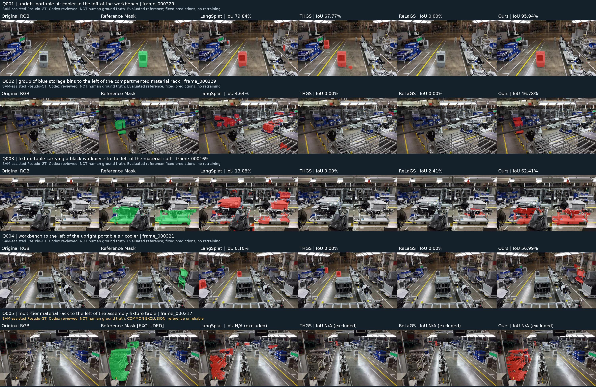
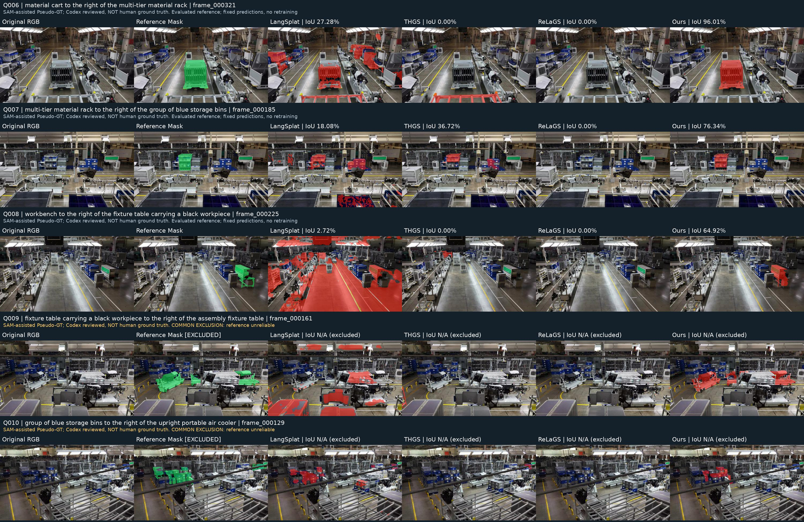
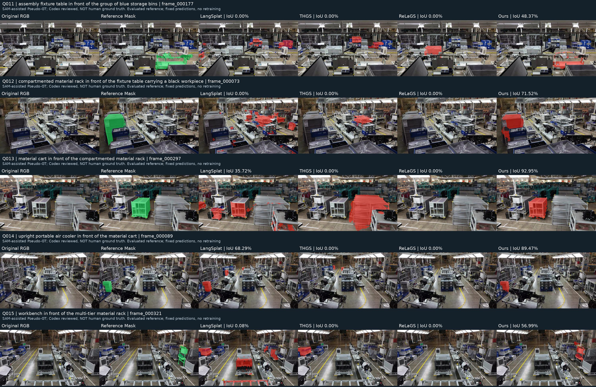
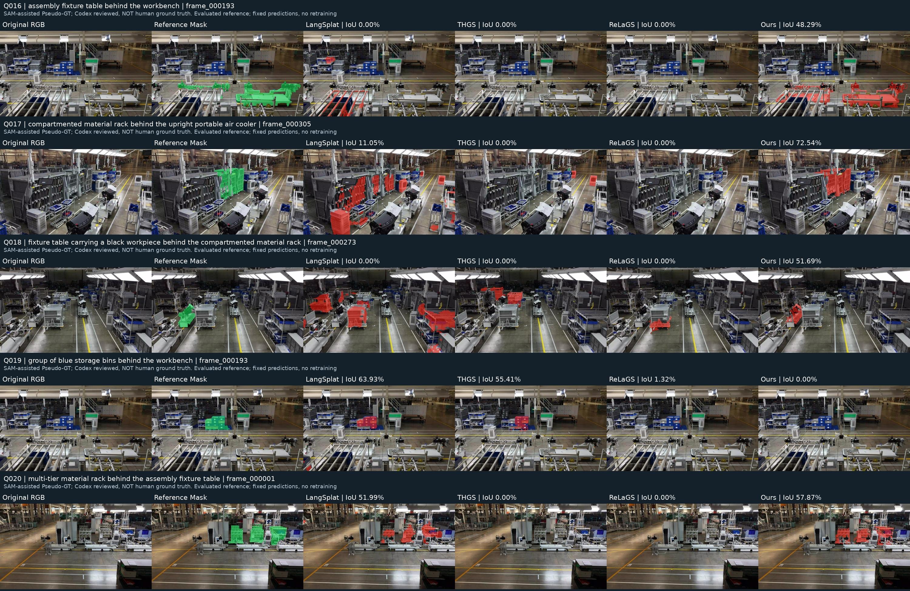
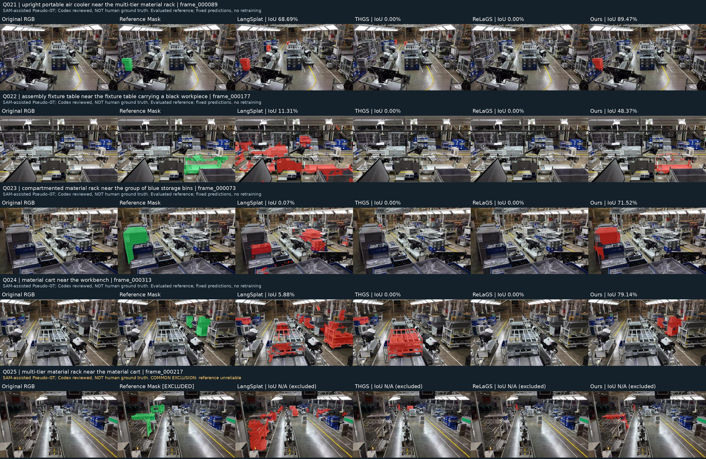
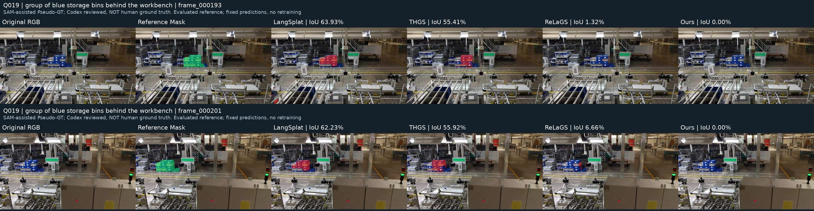

# SAM-assisted Pseudo-GT：定量评价与完整图集

绿色为 SAM 辅助参考掩膜，红色为冻结预测。Codex 视觉检查不是人工真值认证。统一有效集合为 23 条查询、44 个视角；全部 25 条查询、50 个视角均展示。黄色 EXCLUDED 标记的参考仅供查看，不参与任何方法的主指标。

[定量报告](../QUANTITATIVE_EVALUATION_REPORT.md) · [原定性图集与三维结果](GALLERY_QUALITATIVE.md) · [参考质量记录](../evaluation/pseudo_ground_truth/object_quality_review.json)

## 实测汇总

| Method | Projection mIoU | Mean Precision | Mean Recall | Query time (s) |
|---|---:|---:|---:|---:|
| LangSplat | 20.87% | 29.28% | 36.32% | 0.346610 |
| THGS | 8.68% | 14.40% | 10.16% | 0.010730 |
| ReLaGS | 0.35% | 11.00% | 0.35% | 0.106590 |
| Ours | 63.70% | 84.33% | 70.21% | 0.002580 |

## 按关系展示

各总览展示每条查询的第一个固定视角；后面的完整索引包含两个视角。

### left_of

### right_of

### in_front_of

### behind

### near

## 全部查询双视角

| Query | Description | Valid views | Comparison |
|---|---|---:|---|
| Q001 | upright portable air cooler to the left of the workbench | 2/2 | [RGB / Reference / four methods](figures/pseudo_gt/queries/Q001.jpg) |
| Q002 | group of blue storage bins to the left of the compartmented material rack | 2/2 | [RGB / Reference / four methods](figures/pseudo_gt/queries/Q002.jpg) |
| Q003 | fixture table carrying a black workpiece to the left of the material cart | 2/2 | [RGB / Reference / four methods](figures/pseudo_gt/queries/Q003.jpg) |
| Q004 | workbench to the left of the upright portable air cooler | 2/2 | [RGB / Reference / four methods](figures/pseudo_gt/queries/Q004.jpg) |
| Q005 | multi-tier material rack to the left of the assembly fixture table | 0/2 | [RGB / Reference / four methods](figures/pseudo_gt/queries/Q005.jpg) |
| Q006 | material cart to the right of the multi-tier material rack | 2/2 | [RGB / Reference / four methods](figures/pseudo_gt/queries/Q006.jpg) |
| Q007 | multi-tier material rack to the right of the group of blue storage bins | 2/2 | [RGB / Reference / four methods](figures/pseudo_gt/queries/Q007.jpg) |
| Q008 | workbench to the right of the fixture table carrying a black workpiece | 2/2 | [RGB / Reference / four methods](figures/pseudo_gt/queries/Q008.jpg) |
| Q009 | fixture table carrying a black workpiece to the right of the assembly fixture table | 1/2 | [RGB / Reference / four methods](figures/pseudo_gt/queries/Q009.jpg) |
| Q010 | group of blue storage bins to the right of the upright portable air cooler | 1/2 | [RGB / Reference / four methods](figures/pseudo_gt/queries/Q010.jpg) |
| Q011 | assembly fixture table in front of the group of blue storage bins | 2/2 | [RGB / Reference / four methods](figures/pseudo_gt/queries/Q011.jpg) |
| Q012 | compartmented material rack in front of the fixture table carrying a black workpiece | 2/2 | [RGB / Reference / four methods](figures/pseudo_gt/queries/Q012.jpg) |
| Q013 | material cart in front of the compartmented material rack | 2/2 | [RGB / Reference / four methods](figures/pseudo_gt/queries/Q013.jpg) |
| Q014 | upright portable air cooler in front of the material cart | 2/2 | [RGB / Reference / four methods](figures/pseudo_gt/queries/Q014.jpg) |
| Q015 | workbench in front of the multi-tier material rack | 2/2 | [RGB / Reference / four methods](figures/pseudo_gt/queries/Q015.jpg) |
| Q016 | assembly fixture table behind the workbench | 2/2 | [RGB / Reference / four methods](figures/pseudo_gt/queries/Q016.jpg) |
| Q017 | compartmented material rack behind the upright portable air cooler | 2/2 | [RGB / Reference / four methods](figures/pseudo_gt/queries/Q017.jpg) |
| Q018 | fixture table carrying a black workpiece behind the compartmented material rack | 2/2 | [RGB / Reference / four methods](figures/pseudo_gt/queries/Q018.jpg) |
| Q019 | group of blue storage bins behind the workbench | 2/2 | [RGB / Reference / four methods](figures/pseudo_gt/queries/Q019.jpg) |
| Q020 | multi-tier material rack behind the assembly fixture table | 2/2 | [RGB / Reference / four methods](figures/pseudo_gt/queries/Q020.jpg) |
| Q021 | upright portable air cooler near the multi-tier material rack | 2/2 | [RGB / Reference / four methods](figures/pseudo_gt/queries/Q021.jpg) |
| Q022 | assembly fixture table near the fixture table carrying a black workpiece | 2/2 | [RGB / Reference / four methods](figures/pseudo_gt/queries/Q022.jpg) |
| Q023 | compartmented material rack near the group of blue storage bins | 2/2 | [RGB / Reference / four methods](figures/pseudo_gt/queries/Q023.jpg) |
| Q024 | material cart near the workbench | 2/2 | [RGB / Reference / four methods](figures/pseudo_gt/queries/Q024.jpg) |
| Q025 | multi-tier material rack near the material cart | 0/2 | [RGB / Reference / four methods](figures/pseudo_gt/queries/Q025.jpg) |

## 外部方法有效、Ours 失败的案例

Q019：Ours 精细实例不可用，空掩膜按零分计入。保留 LangSplat 和 THGS 的有效蓝色箱组响应。

