# Industrial relational retrieval: complete qualitative results

All masks use the same held-out RGB, camera, 938×528 pixel grid, red color and 55% opacity. These are predictions, not ground truth. No accuracy ranking can be established before independent manual GT.

[Protocol](../EXPERIMENT_PROTOCOL.md) · [Report](../EXPERIMENT_REPORT.md)

## All five relations

### left_of

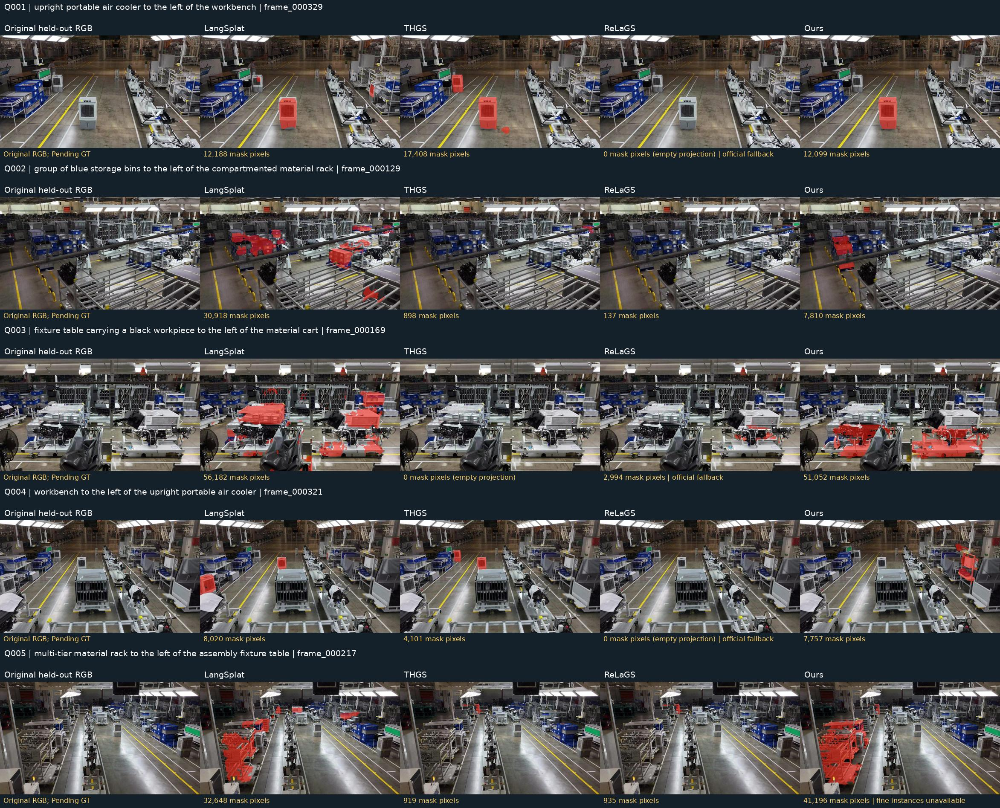

### right_of

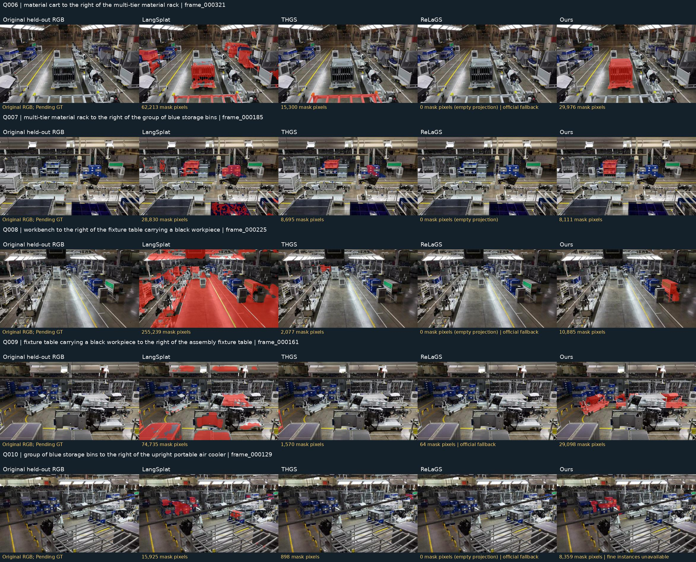

### in_front_of

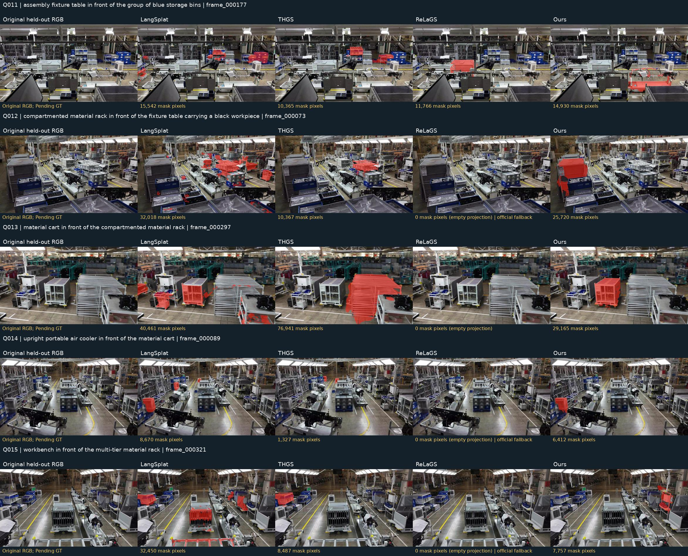

### behind

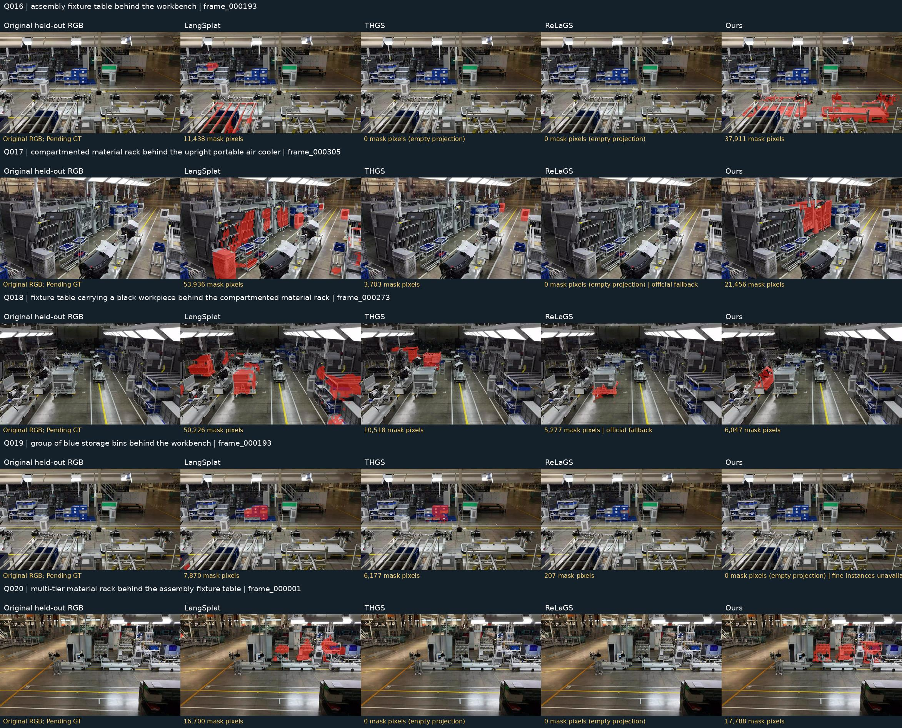

### near

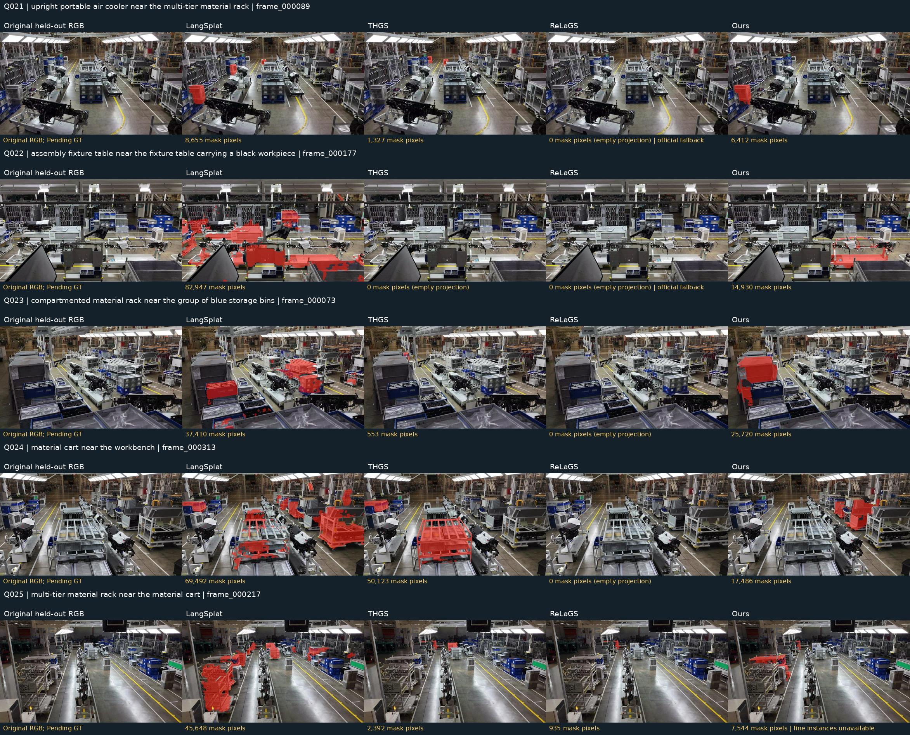

## Representative cases

Chosen to span all eight target categories and all five relations, plus an unavailable-instance case when present; the complete query atlas follows.

### Q001: upright portable air cooler to the left of the workbench

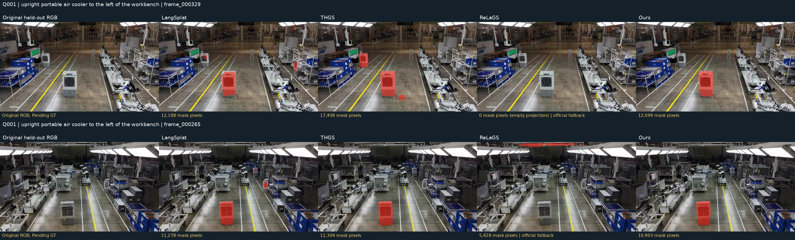

### Q006: material cart to the right of the multi-tier material rack

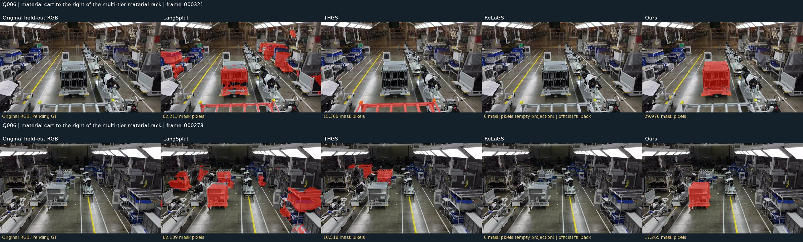

### Q011: assembly fixture table in front of the group of blue storage bins

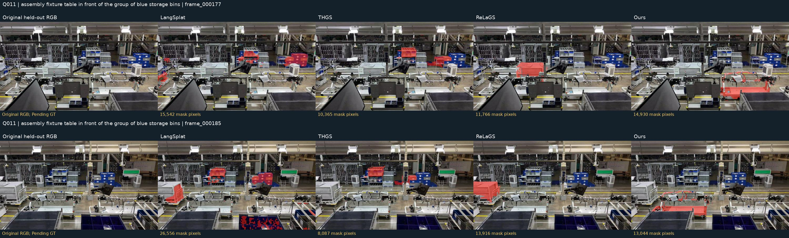

### Q017: compartmented material rack behind the upright portable air cooler

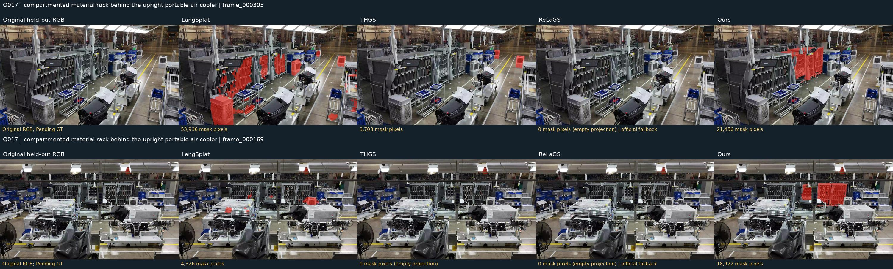

### Q025: multi-tier material rack near the material cart

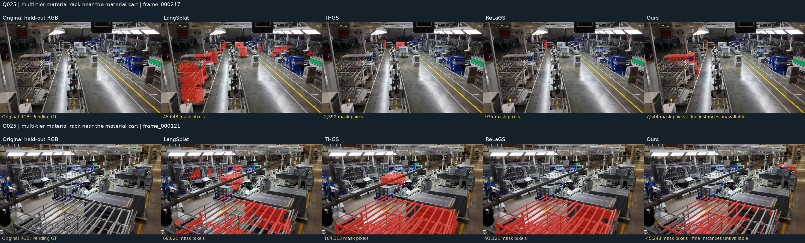

### Q002: group of blue storage bins to the left of the compartmented material rack

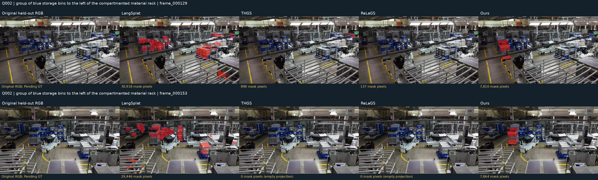

### Q003: fixture table carrying a black workpiece to the left of the material cart

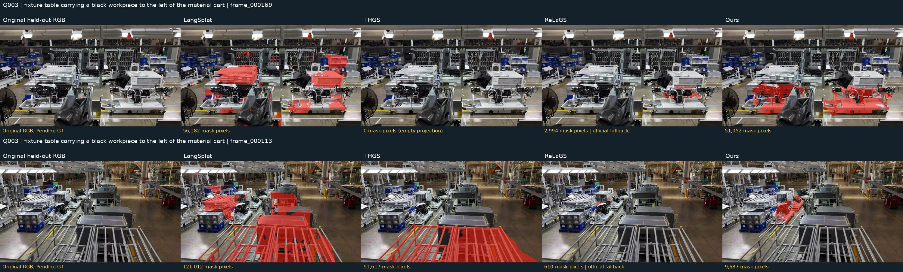

### Q004: workbench to the left of the upright portable air cooler

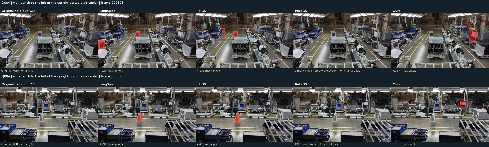

### Q005: multi-tier material rack to the left of the assembly fixture table

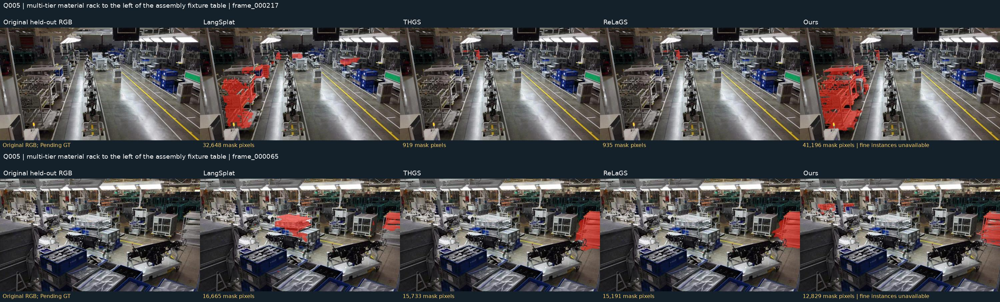

### Q019: group of blue storage bins behind the workbench

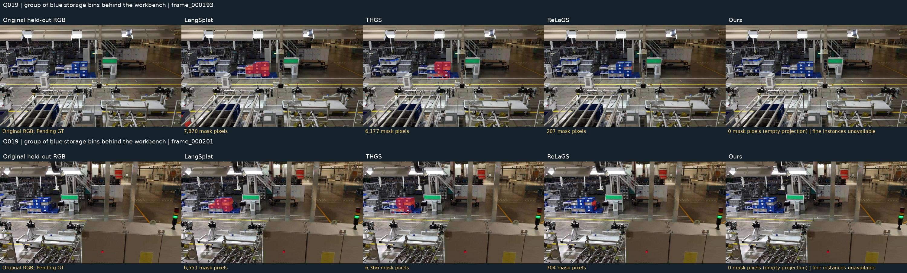

## Complete query index

| Query | Relation | English description | All fixed views |
|---|---|---|---|
| Q001 | left of | upright portable air cooler to the left of the workbench | [Images](figures/queries/Q001.jpg) |
| Q002 | left of | group of blue storage bins to the left of the compartmented material rack | [Images](figures/queries/Q002.jpg) |
| Q003 | left of | fixture table carrying a black workpiece to the left of the material cart | [Images](figures/queries/Q003.jpg) |
| Q004 | left of | workbench to the left of the upright portable air cooler | [Images](figures/queries/Q004.jpg) |
| Q005 | left of | multi-tier material rack to the left of the assembly fixture table | [Images](figures/queries/Q005.jpg) |
| Q006 | right of | material cart to the right of the multi-tier material rack | [Images](figures/queries/Q006.jpg) |
| Q007 | right of | multi-tier material rack to the right of the group of blue storage bins | [Images](figures/queries/Q007.jpg) |
| Q008 | right of | workbench to the right of the fixture table carrying a black workpiece | [Images](figures/queries/Q008.jpg) |
| Q009 | right of | fixture table carrying a black workpiece to the right of the assembly fixture table | [Images](figures/queries/Q009.jpg) |
| Q010 | right of | group of blue storage bins to the right of the upright portable air cooler | [Images](figures/queries/Q010.jpg) |
| Q011 | in front of | assembly fixture table in front of the group of blue storage bins | [Images](figures/queries/Q011.jpg) |
| Q012 | in front of | compartmented material rack in front of the fixture table carrying a black workpiece | [Images](figures/queries/Q012.jpg) |
| Q013 | in front of | material cart in front of the compartmented material rack | [Images](figures/queries/Q013.jpg) |
| Q014 | in front of | upright portable air cooler in front of the material cart | [Images](figures/queries/Q014.jpg) |
| Q015 | in front of | workbench in front of the multi-tier material rack | [Images](figures/queries/Q015.jpg) |
| Q016 | behind | assembly fixture table behind the workbench | [Images](figures/queries/Q016.jpg) |
| Q017 | behind | compartmented material rack behind the upright portable air cooler | [Images](figures/queries/Q017.jpg) |
| Q018 | behind | fixture table carrying a black workpiece behind the compartmented material rack | [Images](figures/queries/Q018.jpg) |
| Q019 | behind | group of blue storage bins behind the workbench | [Images](figures/queries/Q019.jpg) |
| Q020 | behind | multi-tier material rack behind the assembly fixture table | [Images](figures/queries/Q020.jpg) |
| Q021 | near | upright portable air cooler near the multi-tier material rack | [Images](figures/queries/Q021.jpg) |
| Q022 | near | assembly fixture table near the fixture table carrying a black workpiece | [Images](figures/queries/Q022.jpg) |
| Q023 | near | compartmented material rack near the group of blue storage bins | [Images](figures/queries/Q023.jpg) |
| Q024 | near | material cart near the workbench | [Images](figures/queries/Q024.jpg) |
| Q025 | near | multi-tier material rack near the material cart | [Images](figures/queries/Q025.jpg) |

## Isolated 3D regions

THGS, ReLaGS and Ours are rendered on black backgrounds with identical virtual poses and FOV. Within each row all three methods receive the same square pixel crop and resize, preserving their common display scale. Crop parameters are saved in outputs/comparisons/Qxxx/display_crops.json; original full-frame renders remain on the server. These remove scene context for visualization only; all evaluation masks retain full-scene occlusion. LangSplat retains its official per-view output.

- [Q001 isolated 3D comparison](figures/3d/Q001.jpg)
- [Q002 isolated 3D comparison](figures/3d/Q002.jpg)
- [Q003 isolated 3D comparison](figures/3d/Q003.jpg)
- [Q004 isolated 3D comparison](figures/3d/Q004.jpg)
- [Q005 isolated 3D comparison](figures/3d/Q005.jpg)
- [Q006 isolated 3D comparison](figures/3d/Q006.jpg)
- [Q007 isolated 3D comparison](figures/3d/Q007.jpg)
- [Q008 isolated 3D comparison](figures/3d/Q008.jpg)
- [Q009 isolated 3D comparison](figures/3d/Q009.jpg)
- [Q010 isolated 3D comparison](figures/3d/Q010.jpg)
- [Q011 isolated 3D comparison](figures/3d/Q011.jpg)
- [Q012 isolated 3D comparison](figures/3d/Q012.jpg)
- [Q013 isolated 3D comparison](figures/3d/Q013.jpg)
- [Q014 isolated 3D comparison](figures/3d/Q014.jpg)
- [Q015 isolated 3D comparison](figures/3d/Q015.jpg)
- [Q016 isolated 3D comparison](figures/3d/Q016.jpg)
- [Q017 isolated 3D comparison](figures/3d/Q017.jpg)
- [Q018 isolated 3D comparison](figures/3d/Q018.jpg)
- [Q019 isolated 3D comparison](figures/3d/Q019.jpg)
- [Q020 isolated 3D comparison](figures/3d/Q020.jpg)
- [Q021 isolated 3D comparison](figures/3d/Q021.jpg)
- [Q022 isolated 3D comparison](figures/3d/Q022.jpg)
- [Q023 isolated 3D comparison](figures/3d/Q023.jpg)
- [Q024 isolated 3D comparison](figures/3d/Q024.jpg)
- [Q025 isolated 3D comparison](figures/3d/Q025.jpg)
