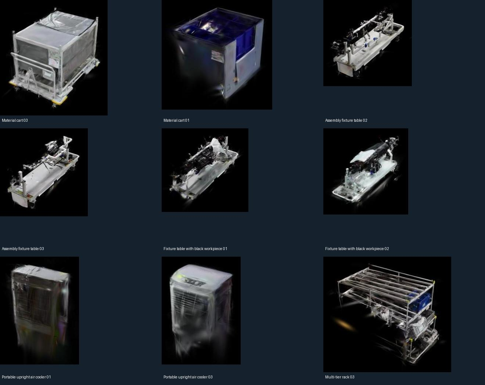
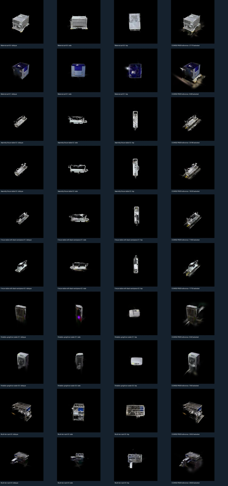
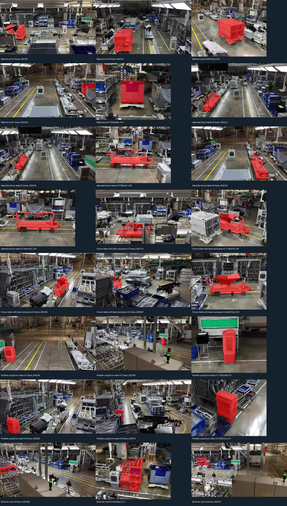
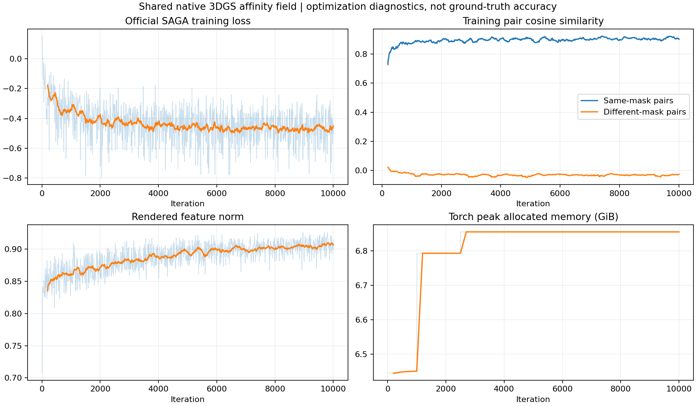
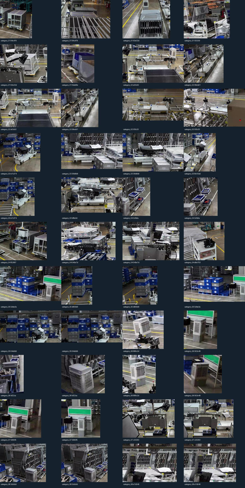
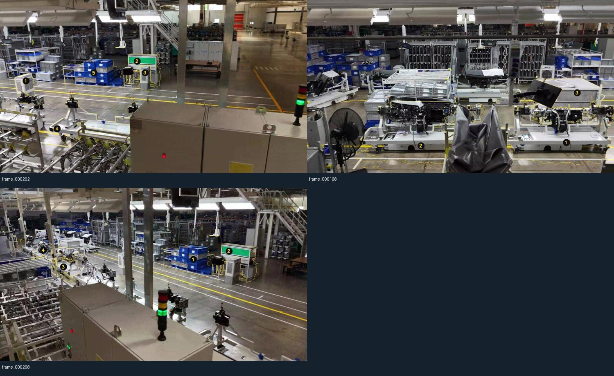
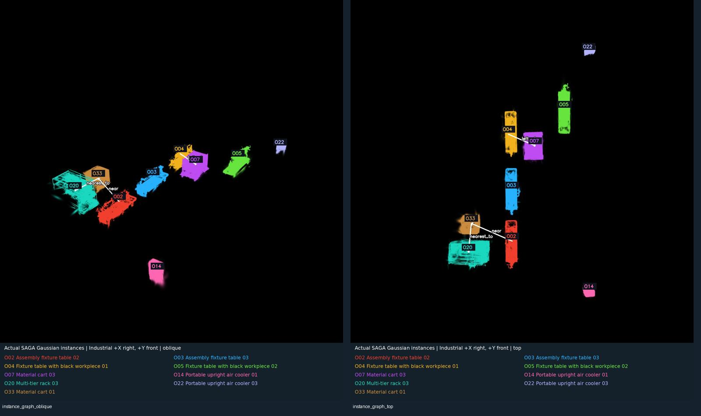
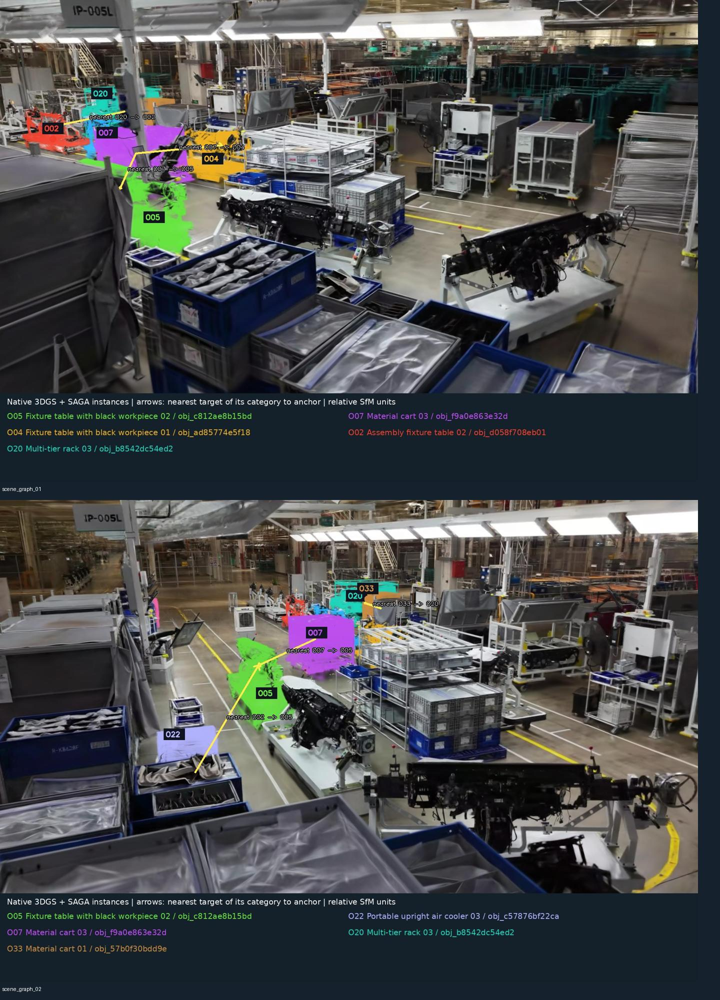
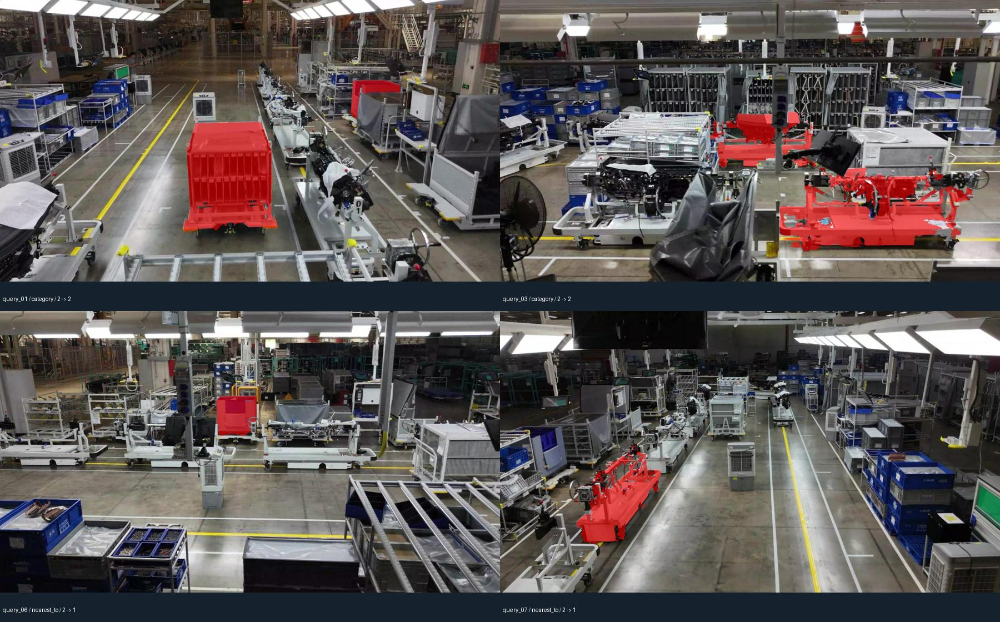
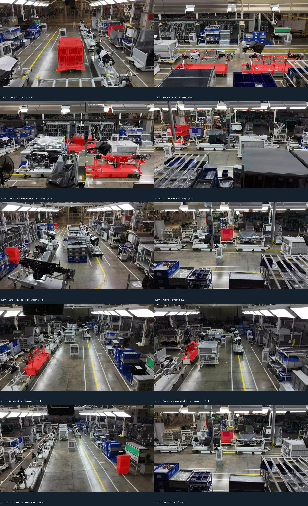

# SAGA + ReLaGS：关键实际结果

10个对象尝试中9个可用于设备级查询展示；1个多层料架失败。图中保留实际缺失和伪影。
场景图有33个M0节点，查询目标只包含9个审核可用实例。视觉语义新增边为0。
关系图仅展示部分几何边；没有人工分割真值，不把提示一致性解释为准确率。

图像为服务器结果的原样复制，来源和SHA-256见 [PUBLICATION_MANIFEST.json](../PUBLICATION_MANIFEST.json)。

## 9个审核可用实例

## 全部10次提取（含失败料架）

## 训练视角投影检查

## 实际训练曲线

## 8类代表图像

## SoM视觉关系检查

## 独立实例与几何关系

## 完整场景中的实例与关系

## 类别及关系查询示例

## 全部10项查询

